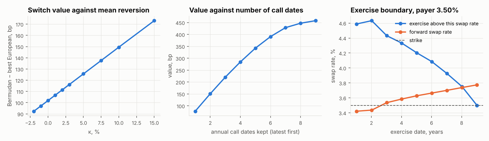

# ratelib — USD rates: curves, volatility, LGM, Bermudan swaptions

A C++20 pricing library built to show how rates products are priced, calibrated and hedged, with every
claim backed by a number the code produces. It builds the curves, fits the swaption cube, calibrates a
one-factor model, prices a Bermudan swaption three independent ways, and gets the risk out.

All numbers below are generated by `rl_analysis` and are reproduced in full, with plots and commentary, in
**[docs/RESULTS.md](docs/RESULTS.md)**. Market: USD as of 2026-09-04 (synthetic but realistic quotes in `data/`).

## Headline results

**A Bermudan swaption priced three ways.** 10-year swap callable annually from year 1, LGM one-factor
calibrated to its nine co-terminal swaptions. Prices in basis points of notional.

| Trade | Best European | Lower bound (LSMC) | PDE | Upper bound (Andersen–Broadie) | Duality gap |
| --- | ---: | ---: | ---: | ---: | ---: |
| Payer 2.50% (ITM) | 738.8 | 851.60 ± 0.14 | 851.42 | 852.33 ± 0.17 | 0.73 ± 0.08 |
| Payer 3.50% (near ATM) | 322.8 | 442.91 ± 0.11 | 442.88 | 443.35 ± 0.12 | 0.43 ± 0.05 |
| Payer 4.50% (OTM) | 144.6 | 222.99 ± 0.10 | 222.98 | 223.17 ± 0.11 | 0.18 ± 0.03 |
| Receiver 3.50% | 331.4 | 431.74 ± 0.16 | 431.91 | 432.29 ± 0.18 | 0.55 ± 0.07 |

The PDE lies within two standard errors of both Monte Carlo bounds on every trade, and is confirmed to
0.001 bp by a fourth, independent method. The duality gap is about 0.1% of the price. PDE: 2 ms per price.

| | Result |
| --- | --- |
| Curve bootstrap | 37 instruments, two coupled curves, repriced to 1e-10 bp in 4 Newton iterations (4 ms). A sequential bootstrap leaves 5 bp. |
| Swap risk by AAD | Delta of a 200-swap book to all 37 curve quotes in 2.2 ms: **about 85× faster** than bump-and-rebuild, agreeing to 1e-5. |
| Swaption cube | 81 SABR nodes fitted to 0.016 bp (the rounding of the quotes); the arbitrageable strikes of each node located. |
| LGM calibration | Co-terminal strip repriced to 1e-12 bp of vol, for any mean reversion. |
| Mean reversion | Moves the Bermudan by 76 bp (κ from −2% to 15%) while every calibration instrument stays repriced. |
| Exposure | A swap's expected exposure profile from the same model equals the market swaption strip; Monte Carlo agrees. |



## What is in it, product by product

| Product | What drives its value | How it is priced here | What the tests check |
| --- | --- | --- | --- |
| OIS swap, SOFR future, basis swap | Discount and projection curves | Closed form off the curves; daily compounding with realised fixings, payment lag, futures convexity as an input | Par instruments reprice to 1e-10; float leg telescopes; adjoint delta = bumped delta |
| European swaption | Forward swap rate, annuity, normal vol at the strike | Bachelier on the market's terms; Jamshidian closed form under LGM | Put–call parity; closed form = numerical integration; reproduces the Hull–White bond-option formula |
| Bermudan swaption | The Europeans it contains, plus how correlated rates are across exercise dates (mean reversion) | Crank–Nicolson PDE; Longstaff–Schwartz lower bound; Andersen–Broadie upper bound | ≥ every European, ≤ their sum; monotone in exercise rights; one date = the European; lower ≤ PDE ≤ upper |
| Swap exposure (EE, PFE) | The same swaption strip | Closed form under LGM; Monte Carlo | Closed form = Monte Carlo; EE(payer) + ENE(receiver) = 0 |

| Model | Role | Where it stops being right (and where that is shown) |
| --- | --- | --- |
| Multi-curve bootstrap | Turns quotes into discount and forward curves | Interpolation choice changes forwards between pillars; futures convexity is an input, not modelled |
| SABR (Hagan expansion) | The smile at each cube node | Negative density at low strikes: a perfect fit is not an arbitrage-free smile |
| LGM one-factor | Dynamics for the Bermudan | One factor: all rates perfectly correlated instantaneously; no smile of its own; mean reversion is not identified by the calibration set |

## Things I measured that were not what the textbook says

- **Rannacher start-up makes the Bermudan price less accurate, not more.** It exists to damp
  Crank–Nicolson's oscillations after each exercise date. Exercise creates a kink, not a jump, and for the
  price plain Crank–Nicolson is the more accurate at every step count I tried. What the start-up buys is a
  smooth gamma. It stays on by default because the output is hedged.
- **PDE error is second order but not monotone.** It depends on where the exercise boundary falls between
  grid nodes; one doubling of the grid can do nothing and the next cut the error sixteen-fold.
- **The 30-year SOFR risk of a swap is not on a SOFR instrument.** There is no 30-year SOFR swap in the
  curve; the point is defined by a Fed Funds swap and a basis swap, and that is where the delta lands.
- **A control variate on the best European did little for the lower bound** (12% on top of antithetic
  paths), so it is not in the code.
- **A subtle derivative bug has no symptom in prices.** In monotone-convex interpolation the breakpoint
  of each segment depends on the curve nodes. Treating it as a constant leaves every discount factor
  right and the Jacobian wrong; it showed up only as adjoint ≠ finite difference.

## Layout

```
cpp/core         dates, calendars, day counts, schedules
cpp/math         interpolation, root finding, Levenberg–Marquardt, normal distribution, RNG
cpp/aad          tape-based adjoint differentiation (the scalar type the curve stack is templated on)
cpp/market       quotes, fixings, yield curves, swaption cube
cpp/instruments  swaps, futures, basis swaps, swaptions; market conventions
cpp/linear       pricing off the curves: leg PV, par rate, annuity
cpp/bootstrap    global multi-curve solve, adjoint Jacobian, par risk
cpp/vol          Bachelier / Black, SABR and its calibration, arbitrage check
cpp/models       LGM one-factor, swaption pricing under it, strip calibration
cpp/pricers      Bermudan by PDE / LSMC / Andersen–Broadie, exposure, risk ladders
cpp/examples     rl_analysis (every number in docs/RESULTS.md) and small demos
tools            results generator, data generators
notebooks        seven walk-throughs of the curve and vol layers
docs             RESULTS.md, DESIGN.md
```

Each `cpp/` module depends only on the ones above it. About 340 C++ test cases and 59 Python tests; the
C++ suite also runs under AddressSanitizer and UBSan.

## Build and run

Linux (Ubuntu 24.04):

```bash
sudo apt-get install -y cmake ninja-build libeigen3-dev catch2 nlohmann-json3-dev
```

```bash
cmake -S . -B build/dev -G Ninja -DCMAKE_BUILD_TYPE=Release && cmake --build build/dev
```

```bash
cd build/dev && ctest
```

Windows (MSVC, with vcpkg and `VCPKG_ROOT` set):

```bash
cmake --preset msvc-release && cmake --build --preset msvc-release && ctest --preset msvc-release
```

Regenerate every table and plot in `docs/RESULTS.md` (about two minutes):

```bash
uv run python tools/make_results.py
```

## Limitations

- **Market data is synthetic.** The curve quotes and the vol screen are realistic in shape and level but
  are not vendor data, and the cube's forwards come from the vol file rather than from the curve.
- **One factor.** LGM cannot decorrelate rates of different maturities, which matters for anything
  depending on curve shape (CMS spreads) and somewhat for Bermudans. Mean reversion is an input here; a desk
  marks it to Bermudan prices or to a second strip.
- **No smile in the model.** LGM is calibrated at the trade's strike. A Bermudan whose exercise boundary
  sits far from the strike sees vols the model was not calibrated to.
- **SABR is Hagan's expansion as published.** Arbitrage at low strikes is detected and reported per node,
  not repaired.
- **Futures convexity adjustments are inputs**, not derived from the model.
- **Single-curve in the model.** The LGM pricers handle SOFR swaps under SOFR discounting; the two-day
  payment lag is frozen at today's curve.
- **Bermudan risk is by bump and re-calibration**, not adjoint. AAD covers the curve layer.
- **Exposure** has no collateral, netting or margin period of risk, and is sampled on coupon dates.
- USD only; no cross-currency.
