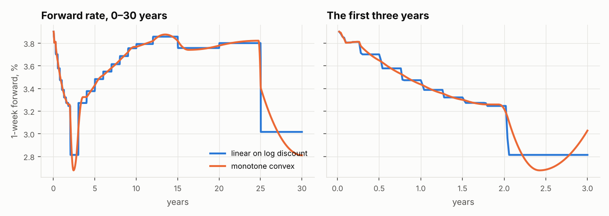
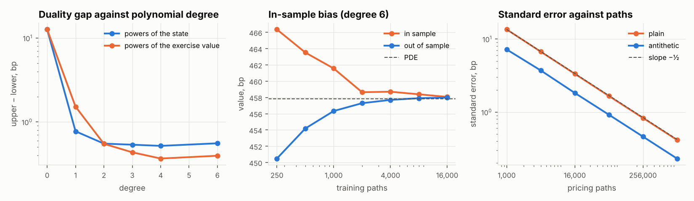
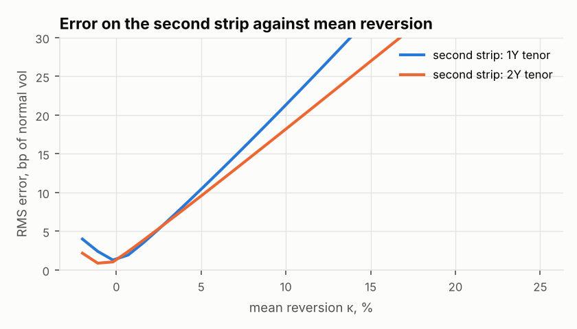
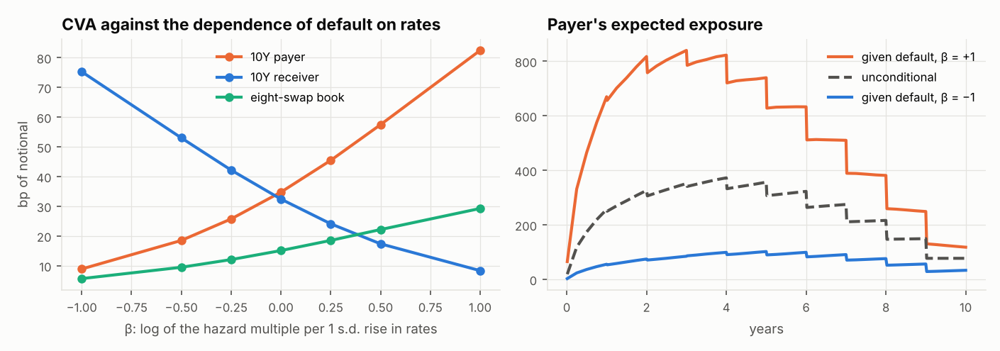
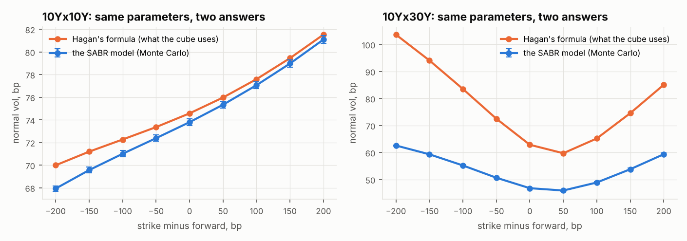
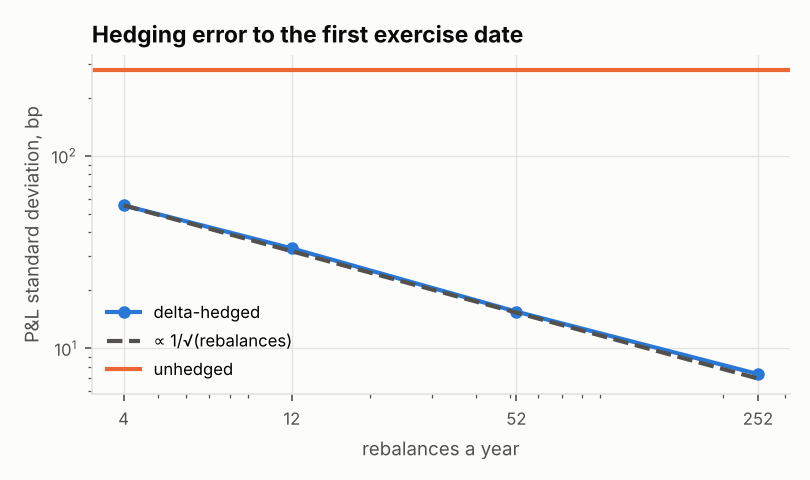

# Results

Everything here is produced by `rl_analysis` (C++) and rendered by `tools/make_results.py`; nothing is typed
in by hand. Market: USD, as of 2026-09-04, from the files in `data/` (the curve quotes and the vol screen are
synthetic but realistic). Prices are in basis points of notional unless stated.

Timings: Intel(R) Xeon(R) Processor @ 2.10GHz, 4 logical cores, Linux x86_64, single-threaded, GCC -O2.

To regenerate:

```bash
cmake -S . -B build/dev -G Ninja -DCMAKE_BUILD_TYPE=Release && cmake --build build/dev
```

```bash
uv run python tools/make_results.py
```

## 1. Curves: USD SOFR and Fed Funds, bootstrapped together

**Product view.** 37 instruments define two curves: SOFR overnight-index swaps and 3-month SOFR futures for
the SOFR curve, Fed Funds–SOFR basis swaps and Fed Funds swaps for the Fed Funds curve. The 25- and 30-year
SOFR points are quoted only through basis swaps, so the SOFR long end depends on the Fed Funds curve while
Fed Funds cashflows are discounted on SOFR. Neither curve can be built before the other.

| Interpolation | Method | Newton iterations | Worst residual (bp) | Worst instrument | Time (ms) |
| --- | --- | ---: | ---: | --- | ---: |
| linear_logdf | global Newton (adjoint Jacobian) | 4 | 4.7e-11 | SOFR-OIS-1W | 4.8 |
| linear_logdf | global Newton (finite-difference Jacobian) | 4 | 6.7e-11 | SOFR-OIS-1W | 31.1 |
| linear_logdf | sequential (one pass curve by curve) | 5 | 5.0e+00 | FF-SOFR-25Y | 3.8 |
| monotone_convex | global Newton (adjoint Jacobian) | 4 | 6.4e-11 | FF-SOFR-30Y | 7.4 |
| monotone_convex | global Newton (finite-difference Jacobian) | 4 | 4.7e-11 | SOFR-OIS-1W | 33.1 |
| monotone_convex | sequential (one pass curve by curve) | 8 | 5.0e+00 | FF-SOFR-25Y | 17.8 |

- The global solve reprices every instrument to about 1e-10 bp in four iterations under both interpolations
  (worst residuals: linear_logdf 4.7e-11 bp, monotone_convex 6.4e-11 bp).
- One pass of the curve-by-curve bootstrap leaves the long basis swaps about 5 bp off, because they were
  solved against a Fed Funds curve that did not exist yet.
- The Jacobian is taken by an adjoint sweep through the same pricing code the solver runs. It gives the same
  answer as finite differences about ten times faster, and stays exact under monotone convex interpolation,
  where a hand-derived Jacobian is easy to get subtly wrong.



*Interpolation is a modelling choice, not a detail.* Linear interpolation of log discount factors gives
piecewise-constant forwards with a jump at every pillar; monotone convex gives continuous forwards. Both
reprice the same quotes exactly. They differ in the forward rate between pillars, which is what a
forward-starting swap or a futures strip is priced on.

## 2. Swap risk: adjoint differentiation against bumping

**Product view.** A swap desk hedges with the instruments the curve is built from, so risk is reported per
par quote: "how much does the book move if the 10-year swap rate rises 1 bp and the curve is rebuilt".

A book of 200 swaps (1–30 years, both directions), delta to all 37 curve quotes:

| Method | Time (ms) | Relative to one valuation |
| --- | ---: | ---: |
| one valuation of the book | 0.26 | 1× |
| adjoint + implicit-function theorem | 1.61 | 6× |
| bump and re-bootstrap each quote | 130.02 | 502× |

- Adjoint: one reverse sweep gives the sensitivity to every curve node; one transposed linear solve with the
  bootstrap Jacobian (implicit-function theorem) converts node risk to par-quote risk. **81× faster**
  than bumping here, and the cost does not grow with the number of quotes.
- The two agree to 1e-05 of the largest delta when the bump is small (0.01 bp). A 1 bp bump differs
  by about 1e-3 because it also contains the gamma.

Largest deltas (currency units per +1 bp, notionals 1–5 million):

| Quote | Adjoint | Bump 1 bp | Bump 0.01 bp |
| --- | ---: | ---: | ---: |
| FF-SOFR-30Y | 101,850.4 | 101,870.0 | 101,850.6 |
| FF-OIS-30Y | 101,646.9 | 101,700.3 | 101,647.5 |
| SOFR-OIS-15Y | 54,407.3 | 54,432.0 | 54,407.5 |
| FF-OIS-25Y | 40,055.8 | 40,157.6 | 40,056.9 |
| FF-SOFR-25Y | 39,754.5 | 39,789.3 | 39,754.9 |
| SOFR-OIS-12Y | 27,846.4 | 27,846.8 | 27,846.4 |
| SOFR-OIS-9Y | 26,686.6 | 26,684.5 | 26,686.6 |
| SOFR-OIS-7Y | -17,807.6 | -17,793.6 | -17,807.5 |

The long-dated risk lands on `FF-OIS-30Y` and `FF-SOFR-30Y`, not on a SOFR swap: there is no 30-year SOFR
swap in the curve, so those two instruments together *are* the 30-year SOFR point. A ladder that showed
"30-year SOFR" would be showing an instrument nobody can trade.

## 3. Volatility: the swaption cube

**Product view.** A European swaption is quoted as a normal (Bachelier) vol of the forward swap rate. The
cube holds one SABR smile per (expiry, tenor): α sets the level, ρ the skew, ν the curvature, with β = 0.5
fixed as policy. α is re-solved from the at-the-money quote at every step of the fit, so every node reprices
its ATM vol exactly and only ρ and ν are searched.

- All 81 nodes fit with no parameter on a bound. Worst residual 0.013 bp
  (3Mx30Y); the quotes are rounded to 0.01 bp, so this is the rounding of the input.
- 3–5 solver iterations per node, from a starting point computed from the smile's
  skew and curvature at the money.
- Normal ↔ shifted-lognormal conversion round-trips to 1e-12. Normal → lognormal can fail (a lognormal price
  is bounded, a normal one is not) and that is reported rather than clamped.

**Where the model breaks.** Hagan's formula is an expansion, not a model: far enough below the forward its
implied density goes negative, which is a butterfly arbitrage. 51 of the 81 nodes have a
negative density somewhere inside four standard deviations. The first few, by expiry:

| Node | Forward % | ATM vol (bp) | ρ | ν | Fit residual (bp) | Density < 0 below strike % |
| --- | ---: | ---: | ---: | ---: | ---: | ---: |
| 1Yx1Y | 3.3252 | 95.40 | -0.0990 | 0.4628 | 0.0037 | 0.027 |
| 1Yx2Y | 3.3843 | 91.29 | -0.1033 | 0.4510 | 0.0049 | 0.027 |
| 1Yx3Y | 3.4297 | 89.96 | -0.1072 | 0.4411 | 0.0057 | 0.027 |
| 1Yx5Y | 3.4961 | 90.43 | -0.1140 | 0.4265 | 0.0020 | 0.027 |
| 1Yx7Y | 3.5442 | 91.52 | -0.1194 | 0.4171 | 0.0034 | 0.028 |
| 1Yx10Y | 3.5982 | 92.12 | -0.1259 | 0.4082 | 0.0028 | 0.028 |
| 2Yx1Y | 3.3726 | 86.75 | -0.1335 | 0.3399 | 0.0049 | 0.051 |
| 2Yx2Y | 3.4292 | 85.41 | -0.1380 | 0.3281 | 0.0025 | 0.051 |
| 2Yx3Y | 3.4724 | 85.48 | -0.1414 | 0.3183 | 0.0032 | 0.051 |
| 2Yx5Y | 3.5348 | 86.75 | -0.1485 | 0.3035 | 0.0028 | 0.031 |
| 2Yx7Y | 3.5796 | 87.70 | -0.1541 | 0.2939 | 0.0043 | 0.031 |
| 2Yx10Y | 3.6295 | 87.85 | -0.1601 | 0.2851 | 0.0030 | 0.031 |


The fit residual says nothing about this: the stressed 10Y×30Y node fits its seven quotes as well as any
other. The check has to be made on the density. It matters for anything that integrates the smile over
strikes (CMS, digitals), and it bounds how far from the money the cube should be read.

## 4. Model: LGM one-factor (Hull–White), calibrated to the co-terminal strip

**Model view.** One Gaussian factor. In the LGM parameterisation the model is two functions: H(t), fixed by
the mean reversion κ, and ζ(t), the variance of the state. A swaption expiring at t depends on ζ only
through ζ(t), so the nine co-terminal swaptions of the 10-year callable swap pin ζ one point at a time by a
1-D root search. The strike is the trade's own (3.50%), read off the smile.

Calibration at κ = 3%:

| Expiry date | Expiry (y) | Tenor (y) | Forward % | Market vol (bp) | Model vol (bp) | Error (bp) | σ (bp) |
| --- | ---: | ---: | ---: | ---: | ---: | ---: | ---: |
| 2027-09-09 | 1.01 | 9.0 | 3.4216 | 92.16 | 92.16 | -5e-13 | 104.5 |
| 2028-09-11 | 2.02 | 8.0 | 3.4364 | 87.94 | 87.94 | 2e-13 | 95.4 |
| 2029-09-10 | 3.02 | 7.0 | 3.5361 | 85.14 | 85.14 | 1e-13 | 90.0 |
| 2030-09-09 | 4.02 | 6.0 | 3.5842 | 82.95 | 82.95 | 7e-13 | 87.0 |
| 2031-09-09 | 5.02 | 5.0 | 3.6280 | 81.79 | 81.79 | 3e-13 | 87.8 |
| 2032-09-09 | 6.02 | 4.0 | 3.6643 | 80.44 | 80.44 | 4e-13 | 84.2 |
| 2033-09-09 | 7.02 | 3.0 | 3.7005 | 79.67 | 79.67 | -1e-14 | 85.4 |
| 2034-09-11 | 8.02 | 2.0 | 3.7378 | 78.66 | 78.66 | 5e-13 | 81.8 |
| 2035-09-10 | 9.02 | 1.0 | 3.7739 | 78.19 | 78.19 | -3e-13 | 84.1 |

Worst repricing error over κ = 0%, 3%, 10%: 7e-13 bp.


*The strip does not identify κ.* All three models reprice the same nine swaptions; they differ in how much
short-rate volatility is needed to do it. Higher κ makes long-dated rates less sensitive to the state, so σ
must rise to keep the same swaption vols. What κ changes is the correlation of rates *across* exercise
dates, which the Europeans cannot see and the Bermudan can (section 6).

## 5. Product: the Bermudan swaption, priced three ways

**Product view.** A 10-year fixed-for-SOFR swap that one side may enter on any of nine annual dates from
year 1 ("10 non-call 1"). On each date the holder compares the value of entering the remaining swap with
the value of keeping the option. Prices are in basis points of notional; κ = 3%.

| Trade | Best European | Lower bound (LSMC) | PDE | Upper bound (A–B) | Duality gap | P(exercise) |
| --- | ---: | ---: | ---: | ---: | ---: | ---: |
| 10nc1 payer 2.50% (ITM) | 744.3 | 864.05 ± 0.15 | 863.86 | 864.55 ± 0.16 | 0.50 ± 0.06 | 90% |
| 10nc1 payer 3.50% (near ATM) | 341.7 | 457.83 ± 0.12 | 457.81 | 458.29 ± 0.13 | 0.46 ± 0.06 | 75% |
| 10nc1 payer 4.50% (OTM) | 157.5 | 233.46 ± 0.11 | 233.50 | 233.68 ± 0.12 | 0.22 ± 0.04 | 57% |
| 10nc1 receiver 3.50% | 347.0 | 447.47 ± 0.17 | 447.66 | 447.97 ± 0.18 | 0.50 ± 0.07 | 60% |

- **Lower bound.** Longstaff–Schwartz: fit an exercise rule by regression on 20,000 paths, then value that
  rule on 4 million independent paths. Any rule is a strategy the holder could follow, so it cannot be
  worth more than the option.
- **Upper bound.** Andersen–Broadie: the dual formulation, with the martingale built from the same rule by
  nested simulation (2,000 outer × 500 inner paths).
- **PDE.** Crank–Nicolson on a 1600 × 1600 grid, converged to about 0.003 bp, and confirmed to 0.001 bp
  by an independent backward induction that integrates against the exact Gaussian transition density.
- The three agree on every trade: the PDE lies within two standard errors of both bounds (the largest
  excursion is 1.2 standard errors), and the duality gap, which is measured much more precisely
  than either bound, is
  0.2–0.5 bp, about 0.1% of the price.
- The Bermudan is worth far more than its best single European: the right to choose the date is a large
  part of the value, more so out of the money.

Wall-clock per pricing (PDE at 400 × 400, which is already within 0.07 bp):

| Trade | PDE (ms) | LSMC, 4M paths (ms) | Upper bound (ms) |
| --- | ---: | ---: | ---: |
| 10nc1 payer 2.50% (ITM) | 2.1 | 1345 | 1364 |
| 10nc1 payer 3.50% (near ATM) | 1.8 | 1940 | 1674 |
| 10nc1 payer 4.50% (OTM) | 1.6 | 2109 | 2170 |
| 10nc1 receiver 3.50% | 2.0 | 1896 | 1741 |

### 5.1 PDE: what converges, and what Rannacher start-up actually buys

Under LGM the deflated value satisfies the heat equation in the variance clock ζ, with no drift or
discounting terms: the change of numeraire has absorbed them.

| Steps (space = time) | Error with Rannacher (bp) | Error, Crank–Nicolson only (bp) | Time (ms) |
| --- | ---: | ---: | ---: |
| 50 | 3.6e+00 | 3.2e+00 | 0.05 |
| 100 | 8.4e-01 | 7.4e-01 | 0.15 |
| 200 | 1.3e-01 | 1.0e-01 | 0.46 |
| 400 | 6.6e-02 | 5.9e-02 | 1.90 |
| 800 | 2.4e-03 | 6.3e-04 | 7.40 |
| 1600 | 2.8e-03 | 2.3e-03 | 23.92 |
| 3200 | 4.9e-05 | 6.0e-05 | 103.58 |


- **Second order overall, not monotone.** The error falls 72,836-fold over a 64-fold refinement, but
  unevenly: it depends on where the exercise boundary falls between grid nodes, so one doubling can change
  it by a factor of 0.9 and another by 56. Convergence has to be judged over several doublings.
- **Rannacher start-up costs price accuracy here.** The textbook advice is to replace the first steps after
  each exercise date with implicit ones, to damp the oscillations Crank–Nicolson would otherwise carry. For
  this payoff the price is *more* accurate without it (middle panel): exercising creates a kink, not a
  jump, and the implicit steps bring their own time-stepping error.
- **It buys smooth greeks.** With few time steps on a fine space grid, the second derivative from plain
  Crank–Nicolson oscillates; with the start-up it does not (right panel). It is on by default because the
  output is hedged, not just quoted.

### 5.2 Monte Carlo: the exercise rule, the bias, the error

PDE reference 457.81 bp.

| Regressors | Degree | Lower bound (bp) | Duality gap (bp) |
| --- | ---: | ---: | ---: |
| state | 0 | 446.83 ± 0.38 | 12.65 ± 0.53 |
| state | 1 | 456.87 ± 0.37 | 0.77 ± 0.08 |
| state | 2 | 457.10 ± 0.37 | 0.55 ± 0.07 |
| state | 3 | 457.18 ± 0.37 | 0.54 ± 0.07 |
| state | 4 | 457.17 ± 0.37 | 0.52 ± 0.07 |
| state | 6 | 457.19 ± 0.37 | 0.56 ± 0.07 |
| exercise value | 0 | 446.83 ± 0.38 | 12.65 ± 0.53 |
| exercise value | 1 | 456.22 ± 0.38 | 1.52 ± 0.13 |
| exercise value | 2 | 457.17 ± 0.37 | 0.55 ± 0.06 |
| exercise value | 3 | 457.17 ± 0.37 | 0.43 ± 0.06 |
| exercise value | 4 | 457.20 ± 0.37 | 0.37 ± 0.06 |
| exercise value | 6 | 457.21 ± 0.37 | 0.40 ± 0.06 |



- **Degree 0** (continuation value = a constant, so the rule cannot see the state) loses about 11 bp, and
  the gap shows it without needing the PDE: the gap is a model-free measure of how good the rule is.
- **Degree 1–2 is already enough** in a one-factor model; beyond degree 3 nothing improves. Regressing on
  the swap's value works as well as regressing on the state, and is the choice that carries over to models
  with more factors.
- **In-sample bias.** Valuing the rule on its own training paths overstates the price, by about
  16 bp with 250 paths; on fresh paths
  the same rule is *below* the true price, as a lower bound must be. The two meet as the training set grows.
  (Averages over 200 seeds.)
- **Error** falls as 1/√N; antithetic paths cut it by 1.8×, the equivalent of 3.2× the paths.

## 6. What drives the Bermudan: model and product behaviour


**Mean reversion.** The calibration swaptions do not move with κ; the Bermudan does.

| κ | Bermudan (bp) | Best European (bp) | Switch value (bp) |
| --- | ---: | ---: | ---: |
| -2.0% | 434.0 | 341.7 | 92.4 |
| -1.0% | 438.8 | 341.7 | 97.1 |
| 0.0% | 443.5 | 341.7 | 101.9 |
| 1.0% | 448.3 | 341.7 | 106.6 |
| 2.0% | 453.0 | 341.7 | 111.4 |
| 3.0% | 457.8 | 341.7 | 116.1 |
| 5.0% | 467.3 | 341.7 | 125.7 |
| 7.5% | 479.3 | 341.7 | 137.6 |
| 10.0% | 491.2 | 341.7 | 149.5 |
| 15.0% | 514.8 | 341.7 | 173.1 |

From κ = -2% to 15% the switch value goes from 92 to
173 bp with every calibration instrument repriced exactly throughout. Higher κ
means a shock today has decayed by the later exercise dates, so the exercise decisions are less correlated
and the right to choose among them is worth more. κ is the number a Bermudan desk marks, and this table is
its price.

**Exercise rights.** Value is non-decreasing in the set of call dates, by construction of the product; the
middle panel adds the nine dates one at a time from the last.

**Exercise boundary** (payer, strike 3.50%):

| Call date | Forward swap rate % | European (bp) | Exercise if swap rate above % | P(exercise here) |
| --- | ---: | ---: | ---: | ---: |
| 2027-09-09 | 3.4216 | 248.7 | 4.5882 | 11.8% |
| 2028-09-11 | 3.4364 | 305.5 | 4.6324 | 11.6% |
| 2029-09-10 | 3.5361 | 341.7 | 4.4319 | 13.0% |
| 2030-09-09 | 3.5842 | 333.9 | 4.3326 | 8.5% |
| 2031-09-09 | 3.6280 | 308.2 | 4.2027 | 8.0% |
| 2032-09-09 | 3.6643 | 264.9 | 4.0846 | 6.3% |
| 2033-09-09 | 3.7005 | 211.6 | 3.9266 | 5.8% |
| 2034-09-11 | 3.7378 | 147.9 | 3.7514 | 5.1% |
| 2035-09-10 | 3.7739 | 77.5 | 3.5000 | 4.8% |

At the last date the boundary is the strike: nothing is left to wait for. Earlier, the swap must be in the
money by a margin, about 100 bp at the first call date, because exercising gives up the remaining
optionality.

## 7. Bermudan risk

Notional 1,000,000, payer 3.50%, κ = 3%. Each number is a full revaluation: bump the market, re-bootstrap
the curve, **re-calibrate the model**, reprice by PDE. Re-calibrating is the point: the hedge instruments
are the co-terminal swaptions, and the model has to keep repricing them after the bump.


**Delta.** Total 286 per bp against 748 for the swap from the first call date: the option's delta
is about 38% of the underlying's.

| Quote | Bermudan | Forward swap |
| --- | ---: | ---: |
| SR3-U6 | -5.0 | -25.0 |
| SR3-Z6 | -5.0 | -25.0 |
| SR3-H7 | -5.0 | -25.0 |
| SR3-M7 | -4.8 | -23.3 |
| SOFR-OIS-3Y | -34.8 | 0.2 |
| SOFR-OIS-4Y | -30.5 | 0.2 |
| SOFR-OIS-5Y | -30.1 | 0.1 |
| SOFR-OIS-6Y | -30.2 | 0.3 |
| SOFR-OIS-7Y | -30.8 | 0.5 |
| SOFR-OIS-8Y | -31.6 | -0.1 |
| SOFR-OIS-9Y | -36.7 | 2.7 |
| SOFR-OIS-10Y | 540.6 | 844.2 |

The swap's delta is one long bucket at 10 years and a short at its 1-year start. The Bermudan has the same
long end and a *short in every intermediate year*: it is a probability-weighted mix of swaps starting in
years 1 to 9, each of which is long the 10-year rate and short the rate to its own start date. No risk
appears beyond 10 years or on the Fed Funds basis.

**Vega**, by calibration instrument:

| Expiry | Bermudan vega | European's own vega | Ratio |
| --- | ---: | ---: | ---: |
| 2027-09-09 | 50.9 | 299.6 | 17% |
| 2028-09-11 | 60.5 | 370.1 | 16% |
| 2029-09-10 | 92.7 | 389.2 | 24% |
| 2030-09-09 | 81.6 | 377.6 | 22% |
| 2031-09-09 | 74.2 | 344.9 | 22% |
| 2032-09-09 | 65.1 | 296.3 | 22% |
| 2033-09-09 | 55.6 | 235.3 | 24% |
| 2034-09-11 | 43.5 | 164.0 | 27% |
| 2035-09-10 | 27.5 | 85.4 | 32% |

Total 552 against 2562 for holding all nine Europeans. Each ratio is roughly the hedge ratio in that
European; they are all well below one because the Bermudan is one option on the best of nine, not nine
options.

## 8. Exposure: the same model, seen from counterparty risk

The expected positive exposure of a swap at a future date is E[max(V, 0)], which is by definition the price
of a European swaption on the remaining swap. A swap's exposure profile is a strip of co-terminal
swaptions: the same instruments the Bermudan is calibrated to. So with this calibration the profile below
is not a model output at all from year 1 on. It is the market's swaption prices.

| Years | EE, closed form (bp) | EE, Monte Carlo (bp) | PFE 97.5% (bp) | ENE (bp) |
| --- | ---: | ---: | ---: | ---: |
| 0.01 | 19.2 | 19.3 ± 0.2 | 136 | -61.6 |
| 1.01 | 248.7 | 247.6 ± 1.6 | 1212 | -307.4 |
| 2.02 | 305.5 | 301.7 ± 1.9 | 1395 | -347.0 |
| 3.02 | 341.7 | 344.4 ± 2.0 | 1419 | -321.4 |
| 4.02 | 333.9 | 332.8 ± 1.8 | 1309 | -294.1 |
| 5.02 | 308.2 | 304.5 ± 1.6 | 1143 | -258.7 |
| 6.02 | 264.9 | 265.9 ± 1.3 | 933 | -215.0 |
| 7.02 | 211.6 | 211.7 ± 1.0 | 706 | -166.8 |
| 8.03 | 147.9 | 148.1 ± 0.7 | 468 | -113.2 |
| 9.02 | 77.5 | 78.0 ± 0.3 | 231 | -57.8 |


- The closed form and a 50,000-path simulation agree within sampling error at every date, which is how an
  exposure engine can be validated against a pricing model.
- The hump is diffusion against amortisation: rate uncertainty grows with time while the remaining annuity
  shrinks.
- CVA on this swap is this strip weighted by default probabilities. The right to cancel the swap is the
  Bermudan of section 5 on the offsetting swap. The exposure world and the exotics world are pricing the
  same options.

Not modelled: collateral, netting, margin period of risk, wrong-way risk.

## 9. A second factor: G2++

**Model view.** One factor moves every rate together. G2++ has two Gaussian factors with different mean
reversions and a correlation ρ between them, so the curve can steepen and flatten as well as shift. It is
written here in the same deflated-bond form as the one-factor model: the state is driftless, the curve is
fitted by construction, and Monte Carlo steps are exact. A common volatility scale s(t) carries the level;
the two speeds, the volatility ratio and ρ carry the shape.

### 9.1 European swaptions: one closed form and a one-dimensional integral

With two states there is no single exercise point, so Jamshidian's decomposition does not apply directly.
Conditioning on one direction of the state brings it back: the inner expectation is a closed form and the
outer integral is one-dimensional. Price of a 5Y×10Y payer against two-dimensional numerical integration:

| Gauss–Hermite points | Price (bp) | Error (bp) | Time (µs) |
| ---: | ---: | ---: | ---: |
| 2 | 423.540144 | 3e-06 | 5 |
| 4 | 423.540146 | 3e-08 | 11 |
| 8 | 423.540146 | 3e-08 | 21 |
| 16 | 423.540146 | 3e-08 | 41 |
| 24 | 423.540146 | 3e-08 | 60 |

Four points already give the price to 3e-08 bp. That is a consequence of the direction chosen for the
closed form. Brigo and Mercurio condition on the first factor; that is exact, but when the factors are
highly correlated the remaining integrand tends to the kinked payoff and the quadrature stops converging.
Taking the closed form along the direction that decides exercise leaves an integrand that is almost flat,
and exactly constant in the one-factor limit. The tests check the formula against their bond-option
formula, against two-dimensional integration, and against the one-factor model when the second factor is
switched off.

### 9.2 Shape from the ATM matrix: what the second factor buys

Both models are fitted to 30 ATM swaptions (expiries 1Y–10Y, tenors 1Y–20Y) with the same freedom in the
level: one volatility scale per expiry row. What is left to explain is the tenor direction, which is where
a second factor can help. The two-factor fit is run from four starting points.

| Model | Start | κ₁ | κ₂ | σ₂/σ₁ | ρ | RMS error (bp) | Worst (bp) | Corr(1Y, 10Y fwd) |
| --- | --- | ---: | ---: | ---: | ---: | ---: | ---: | ---: |
| one factor |  | 0.8% |  |  |  | 1.72 | 4.28 | 1.000 |
| two factors | κ₁ 0.1 ρ -0.9 | 37.6% | 3.1% | 0.81 | -0.72 | 0.12 | 0.30 | 0.549 |
| two factors | κ₁ 0.1 ρ 0.5 | 0.8% | 0.8% | 0.28 | +0.09 | 1.72 | 4.28 | 1.000 |
| two factors | κ₁ 0.6 ρ -0.9 | 37.6% | 3.1% | 0.81 | -0.72 | 0.12 | 0.30 | 0.549 |
| two factors | κ₁ 0.6 ρ 0.5 | 37.6% | 3.1% | 0.81 | -0.72 | 0.12 | 0.30 | 0.549 |

Fit errors in bp of normal vol, one factor / two factors (best start), by expiry (rows) and tenor (columns):

| Expiry | 1Y | 2Y | 5Y | 10Y | 20Y |
| --- | ---: | ---: | ---: | ---: | ---: |
| 1Y | -1.3 / +0.1 | +2.2 / +0.1 | +1.8 / +0.1 | -1.8 / -0.0 | -0.9 / -0.3 |
| 2Y | +1.3 / -0.2 | +2.4 / +0.0 | +0.0 / +0.1 | -2.8 / +0.1 | -1.1 / -0.1 |
| 3Y | +1.9 / -0.2 | +1.8 / -0.0 | -0.8 / +0.1 | -2.8 / +0.1 | -0.3 / -0.1 |
| 5Y | +1.0 / -0.1 | +0.5 / +0.0 | -1.3 / +0.1 | -1.7 / +0.1 | +1.5 / -0.1 |
| 7Y | -0.2 / -0.1 | -0.5 / -0.0 | -1.3 / +0.0 | -0.9 / +0.0 | +3.1 / +0.1 |
| 10Y | -1.3 / -0.1 | -1.2 / -0.1 | -1.3 / -0.0 | -0.1 / -0.1 | +4.3 / +0.2 |

- **The second factor takes the error from 1.72 bp to 0.12 bp.** One mean reversion can tilt the tenor
  direction one way; it cannot produce a vol that is as high at 10 years as at 2 years and lower at 20.
- **The shape is identified, and it is the one the data was built with.** 3 of the 4 starts end at the same
  point: κ₁ = 37.6%, κ₂ = 3.1%, σ₂/σ₁ = 0.81, ρ = -0.72. The vol screen's ATM levels were
  generated from a two-factor Gaussian model with a = 40%, b = 3%, η/σ = 0.79, ρ = −0.70
  (`tools/gen_vol_quotes.py`), through the frozen-weights swap-rate formula and a smooth volatility scale.
  The calibration uses exact pricing and a piecewise-constant scale, and the remaining 0.12 bp and the
  small differences in the parameters are the distance between those two descriptions.
- **Not every start gets there.** From κ₁ 0.1 ρ 0.5 it stops at 1.72 bp with ρ = +0.09. The objective has a second,
  one-factor-like basin, and Levenberg–Marquardt is a local method. Running several starts is part of the
  calibration, not a diagnostic.
- With these parameters the instantaneous correlation between the 1-year and 10-year forward rates is
  0.55: far from the 1.00 a one-factor model assumes.

This is a recovery test, not a market calibration: the screen is synthetic. What it shows is that the
calibration finds a two-factor structure when one is there, and says so when it is not (an earlier
version of the screen, generated from smooth surfaces with no correlation structure behind them, gave
four different answers from four starts).

### 9.3 The Bermudan: the same Europeans, a different correlation

Holding the shape fixed, the volatility scale is bootstrapped to the co-terminal strip of the 10nc1 payer
at 3.50%, one expiry at a time, exactly as ζ is in the one-factor model. Every model below reprices the
nine Europeans (worst error 1e-12 bp of vol). They differ only in how rates on different exercise dates
are correlated. Prices are Longstaff–Schwartz lower bounds on one million paths, regressing on both states.

| Model | ρ | Corr(1Y, 10Y fwd) | Bermudan (bp) | Switch value (bp) | Strip error (bp) |
| --- | ---: | ---: | ---: | ---: | ---: |
| One factor, PDE |  | 1.000 | 457.81 | 116.1 | 7.2e-13 |
| Two-factor code, second factor off |  | 1.000 | 457.81 ± 0.32 | 116.1 | 5.5e-13 |
| Fast second factor | +0.9 | 0.985 | 490.47 ± 0.33 | 148.8 | 1.1e-12 |
| Fast second factor | +0.5 | 0.922 | 483.22 ± 0.32 | 141.6 | 6.5e-13 |
| Fast second factor | +0.0 | 0.837 | 470.41 ± 0.32 | 128.7 | 5.7e-13 |
| Fast second factor | -0.5 | 0.753 | 449.22 ± 0.32 | 107.6 | 4.7e-13 |
| Fast second factor | -0.9 | 0.789 | 417.35 ± 0.32 | 75.7 | 8.4e-13 |
| Shape fitted to the ATM matrix | -0.72 | 0.549 | 435.32 ± 0.33 | 93.7 | 4.3e-13 |


- **The pricer is validated where the answer is known.** With the second factor switched off the two-factor
  Monte Carlo gives 457.81 ± 0.32 bp against the one-factor PDE's 457.81 bp.
- **Correlation moves the Bermudan by 73 bp** (from 417.3 to 490.5 bp as ρ goes from −0.9 to +0.9)
  while every calibration instrument stays repriced. That is the same order as the effect of mean reversion
  in section 6, and for the same reason: the Europeans fix the variance of each swap rate on its own
  exercise date and say nothing about how the rates on different dates move together.
- **Which correlation matters.** The prices are not ordered by the correlation between forward rates of
  different maturities (third column): the highest price has the highest such correlation. What the
  Bermudan prices is correlation across TIME, between the swap rates seen on different exercise dates. A
  fast factor's shocks have died out by the later dates. Positively correlated with the slow factor, it
  makes recent shocks count for more than old ones, which is what extra mean reversion does, and the
  switch value rises. Negatively correlated, it offsets recent shocks, acts like negative mean reversion,
  and the value falls below the one-factor price.
- **With the shape fitted to the ATM matrix the Bermudan is 435.3 bp, 22.5 bp below the one-factor
  price at κ = 3%.** Given 9.2 this is a calibrated number, not one point in a range. It is also close to
  what the one-factor model gives once its mean reversion is marked (section 10), which is the same
  information reaching the price by a cruder route.

Not done: an upper bound for the two-factor price (the duality gap of the one-factor rule in section 5 was
below one basis point, and the same regression is used here on two states), and risk under the two-factor
model.

### 9.4 A CMS spread option: the product that prices the correlation

The option pays max(S₁₀ − S₂ − K, 0) in 5 years, where S₁₀ and S₂ are the 10-year and 2-year swap rates
then. Its value is the variance of the spread, σ₁₀² + σ₂² − 2ρσ₁₀σ₂. The two volatilities are swaption
vols; the correlation between the two rates is in no swaption price.

Every model below reprices the 5Y×2Y and 5Y×10Y swaptions (81.4 and 81.1 bp) exactly, so they agree on
both volatilities. The strike is the spread of the two forward rates today, 20.0 bp. Speeds are the
fitted κ₁ and κ₂; for each ρ the level and σ₂/σ₁ are solved for.

| Model | ρ (factors) | σ₂/σ₁ | Rate correlation | Spread vol (bp) | Price, K − 25 bp | Price, K (bp) | Price, K + 25 bp |
| --- | ---: | ---: | ---: | ---: | ---: | ---: | ---: |
| One factor |  |  | 1.000 | 0.3 | 31.3 | 10.1 | 0.0 |
| Two factors | -0.97 | 0.35 | 0.427 | 86.9 | 81.7 | 70.0 | 59.4 |
| Two factors | -0.95 | 0.36 | 0.502 | 81.1 | 77.5 | 65.7 | 55.1 |
| Two factors | -0.90 | 0.40 | 0.644 | 68.5 | 68.5 | 56.5 | 45.9 |
| Two factors | -0.85 | 0.44 | 0.746 | 57.9 | 60.9 | 48.7 | 38.1 |
| Two factors | -0.80 | 0.49 | 0.823 | 48.3 | 54.2 | 41.6 | 31.1 |
| Two factors | -0.75 | 0.57 | 0.886 | 38.8 | 47.6 | 34.6 | 24.0 |
| Fitted to the ATM matrix | -0.72 | 0.81 | 0.961 | 22.7 | 37.3 | 22.8 | 12.2 |

- **One factor prices the option at its intrinsic value.** With both vols matched the two rates are
  perfectly correlated, the spread has 0.3 bp of volatility, and the 10.1 bp that is left is the
  convexity difference between the two rates, not optionality. The 25 bp out-of-the-money call is
  worth 0.00 bp.
- **Two factors move the price from 35 to 70 bp** as ρ goes from -0.75 to -0.97, with both
  swaptions repriced to 1e-12 bp throughout. The price is a direct reading of the rate correlation,
  which runs from 0.89 down to 0.43. This is why spread options are what a desk marks ρ to.
- **The two swaption vols already bound ρ.** For ρ = -0.60, -0.30, +0.00 no σ₂/σ₁ reprices both: with these
  speeds, a 10-year vol as high as the 2-year one needs strongly negatively correlated factors. The
  calibration reports that instead of returning a best effort.
- **The matrix-fitted model gives 22.8 bp**, with a rate correlation of 0.96. It reprices the two
  swaptions to 0.08 bp, not exactly, and has a time-dependent volatility scale, so it is not on the line
  of constant-parameter models above. That the ATM matrix alone leaves this much room (23 bp against
  35–70 bp) is the practical argument for calibrating to a spread option when one is traded.

One payment at expiry with unit accrual, 64 ms per price by two-dimensional quadrature.

## 10. Marking the mean reversion

Sections 4 and 6 left κ as an input: the co-terminal strip is repriced at any κ, and the Bermudan moves by
tens of basis points with it. A second set of swaptions with the same expiries and a different tenor does
see κ. Given ζ(t), the model vol of a short swap starting at t scales with e^(−κt), while the co-terminal
swap's vol is held fixed by the calibration. So κ is chosen to minimise the error on the second set,
re-bootstrapping ζ to the co-terminal strip at every trial value.

| Second strip (expiries 1Y–9Y) | κ | RMS error on it (bp) | Co-terminal strip error (bp) | Bermudan (bp) |
| --- | ---: | ---: | ---: | ---: |
| 1Y | -0.05% | 1.26 | 1.4e-12 | 443.31 |
| 2Y | -0.71% | 0.63 | 8.7e-13 | 440.14 |



- The objective has a clear interior minimum: κ is identified by either strip.
- The two choices of second strip give -0.05% and -0.71%, and Bermudan prices 3.2 bp apart.
  That spread is what is left of the 81 bp range of section 6 once κ is marked.
- **The reference κ = 3% used in sections 4–8 was a convention, and the market disagrees with it.** Marked,
  κ is close to zero and the Bermudan is 14.5 bp lower (443.31 against 457.81 bp). The two-factor
  model fitted to the whole ATM matrix moves the price the same way, and further (section 9.3).
- One number cannot reprice nine instruments. The errors on the 1Y-tenor strip, by expiry, are
  -2.7, +1.2, +1.8, +0.9, +0.5, -0.2, -0.6, -0.7, -0.5 bp.
  They change sign along the strip: a pattern, not noise, and what a time-dependent mean reversion or a
  second factor would be fitted to.

## 11. XVA: from exposure to price

Section 8 stopped at one swap's uncollateralised exposure profile. This section prices it: a credit curve,
a netting set, collateral, a Bermudan, the sensitivities, the same under two factors, and wrong-way risk. Unless stated the
model is the one-factor LGM of section 4 (κ = 3%, calibrated to the 10-year co-terminal strip). All exposures are discounted expectations of
deflated values, so CVA is exposure weighted by default probabilities with no further discounting.

### 11.1 The credit curve

Hazard rates, constant between CDS maturities, bootstrapped so that each quoted spread makes its CDS worth
zero (quarterly premiums with accrual on default, recovery 40%). The counterparty's curve:

| CDS maturity | Spread (bp) | Hazard rate on the interval (%) | Survival to maturity (%) |
| --- | ---: | ---: | ---: |
| 1Y | 80 | 1.33 | 98.7 |
| 3Y | 105 | 1.97 | 94.9 |
| 5Y | 125 | 2.66 | 89.9 |
| 7Y | 140 | 3.10 | 84.5 |
| 10Y | 150 | 3.04 | 77.2 |

Both curves reprice their quotes to machine precision. Our own curve, for DVA, is 40 bp at one year rising to
78 bp at ten. The funding spread for FVA is a flat 60 bp. The spreads are illustrative, not a market's.

### 11.2 One swap: the engine against a closed form

For a single swap the expected positive exposure on a coupon date is a European swaption on the remaining
swap, so its CVA is a strip of swaptions with no simulation error. The Monte Carlo engine, which revalues
the swap on every path, must reproduce it. 10-year payer at 3.50%, 100,000 paths:

| Years | EPE, closed form (bp) | EPE, engine (bp) | ENE, closed form (bp) | ENE, engine (bp) |
| ---: | ---: | ---: | ---: | ---: |
| 1.01 | 248.7 | 248.3 ± 1.1 | -307.4 | -306.1 |
| 2.02 | 305.5 | 304.5 ± 1.3 | -347.0 | -347.5 |
| 3.02 | 341.7 | 341.2 ± 1.4 | -321.4 | -322.3 |
| 4.02 | 333.9 | 333.1 ± 1.3 | -294.1 | -294.9 |
| 5.02 | 308.2 | 307.3 ± 1.1 | -258.7 | -260.8 |
| 6.02 | 264.9 | 263.8 ± 0.9 | -215.0 | -216.4 |
| 7.02 | 211.6 | 210.6 ± 0.7 | -166.8 | -166.8 |
| 8.03 | 147.9 | 147.2 ± 0.5 | -113.2 | -113.3 |
| 9.02 | 77.5 | 77.3 ± 0.2 | -57.8 | -58.0 |

| Method | CVA (bp) | DVA (bp) | FCA (bp) | FBA (bp) |
| --- | ---: | ---: | ---: | ---: |
| closed form | 30.62 | 15.10 | 13.28 | 12.52 |
| Monte Carlo | 30.53 | 15.14 | 13.24 | 12.54 |

CVA is the expected loss if the counterparty defaults while owing us; DVA is the mirror image on our own
default; FCA and FBA are the cost and benefit of funding the uncollateralised asset and liability at our
spread. Payer and receiver are each other's mirror: one side's CVA exposure is the other's DVA exposure,
which is tested.

### 11.3 A netting set

Eight swaps with one counterparty (values today in bp of a unit notional; the book is worth +100.1 bp):

| Trade | Tenor | Fixed rate % | Side | Notional | Value (bp) |
| ---: | ---: | ---: | --- | ---: | ---: |
| 1 | 10Y | 3.50 | pay fixed | 1.0 | -42.3 |
| 2 | 7Y | 3.40 | receive fixed | 0.8 | +19.9 |
| 3 | 5Y | 3.60 | pay fixed | 1.2 | -165.3 |
| 4 | 3Y | 3.30 | receive fixed | 1.5 | +8.5 |
| 5 | 2Y | 3.50 | pay fixed | 1.0 | -0.8 |
| 6 | 10Y | 3.70 | receive fixed | 0.6 | +126.9 |
| 7 | 7Y | 3.20 | pay fixed | 0.5 | +49.8 |
| 8 | 5Y | 3.55 | receive fixed | 0.9 | +103.3 |

Exposure is simulated on 51 dates (quarterly, plus every coupon date) with 50,000 paths; one run takes
1.9 s.


| Agreement | CVA (bp) | DVA (bp) | FCA (bp) | FBA (bp) |
| --- | ---: | ---: | ---: | ---: |
| No netting agreement | 97.48 | — | 44.98 | — |
| Netted; no collateral | 15.17 | 2.88 | 6.66 | 2.09 |
| Zero threshold; 10-day margin period | 0.88 | 0.58 | 0.38 | 0.45 |
| Threshold 50 bp of notional | 3.88 | 0.89 | 1.80 | 0.65 |
| Minimum transfer 10 bp | 0.89 | 0.58 | 0.38 | 0.45 |
| Zero threshold; 20-day margin period | 1.14 | 0.72 | 0.50 | 0.56 |

- **Netting cuts CVA from 97.5 to 15.2 bp**, a factor of 6.4. Without a netting agreement each trade is a
  separate claim and the offsetting payers and receivers both count; with one, only the net does.
- **Collateral with a zero threshold cuts it again to 0.88 bp, and not to zero.** What is left is the
  move of the book over the 10-day margin period of risk, during which no more collateral arrives.
  Doubling the period raises CVA by a factor of 1.29. A pure diffusion would give √2 = 1.41; the rest is
  the coupon effect below, which does not scale with the period.
- **A threshold is uncollateralised exposure by design:** 50 bp of notional leaves 3.88 bp of CVA.
- **A minimum transfer amount barely matters** (0.89 against 0.88 bp). A call that is not made leaves a
  small value uncollateralised in both directions, so to first order it adds as much as it removes.
- **Collateralised exposure spikes on coupon dates.** Away from them the residual exposure averages
  4.8 bp; on them, 18.2 bp. When a coupon rolls off, the book's value jumps by the net
  coupon while the collateral held was called on the value before it. This is the part of collateralised
  exposure a diffusion-only argument misses.

### 11.4 The Bermudan: an option that turns into a swap

A swap's future value is a known function of the state. A Bermudan's is not: on each path it is either
still an option, worth the larger of exercise and continuation, or it has been exercised and the holder
owns the remaining swap. The continuation value is computed as a function of the state at every exercise
date by backward induction with exact Gaussian transitions, and paths are then exercised optimally.

The same simulation reproduces the price: 457.81 bp from the grid and 455.83 ± 0.94 bp from the
paths, against 457.81 bp from the PDE of section 5.

| Years | EPE (bp) | of which option | of which swap | ENE (bp) | Exercised by then | Underlying swap's EPE (bp) |
| ---: | ---: | ---: | ---: | ---: | ---: | ---: |
| 0.00 | 457.8 ± 0.0 | 457.8 | 0.0 | 0.0 | 0% | 0.0 |
| 1.01 | 457.2 ± 0.6 | 336.9 | 120.3 | 0.0 | 11% | 248.7 |
| 2.02 | 439.9 ± 0.8 | 228.3 | 211.6 | -1.4 | 23% | 305.5 |
| 3.02 | 420.0 ± 0.9 | 129.6 | 290.4 | -3.8 | 36% | 341.7 |
| 4.02 | 381.0 ± 0.8 | 74.7 | 306.3 | -7.5 | 45% | 333.9 |
| 5.02 | 334.0 ± 0.8 | 39.3 | 294.7 | -11.7 | 53% | 308.2 |
| 6.02 | 278.0 ± 0.6 | 19.3 | 258.8 | -14.4 | 59% | 264.9 |
| 7.02 | 216.8 ± 0.5 | 7.5 | 209.3 | -15.9 | 65% | 211.6 |
| 8.03 | 149.2 ± 0.3 | 2.0 | 147.2 | -13.9 | 70% | 147.9 |
| 9.02 | 77.2 ± 0.2 | 0.0 | 77.2 | -8.9 | 75% | 77.5 |


- **Before the first exercise date the exposure is the option's price**, 458 bp, far above the
  underlying swap's exposure at the same dates. The option is an asset on every path; the swap is one on
  about half of them.
- **Exercise replaces option exposure with swap exposure.** By year 5, 88% of the exposure is the swap's
  (53% of paths have exercised; that frequency is under the model's pricing measure, not a real-world
  probability). At the last date the two profiles meet: the option is gone.
- **Negative exposure appears only after exercise**, on paths where rates fell after the holder entered
  the swap: -8.9 bp at the end, against the swap's own which is several times larger. The
  holder chose when to enter.
- **CVA of the Bermudan is 38.5 bp against 30.6 bp for the swap**, and its DVA is 0.6 bp against
  15.1 bp. Buying the option is taking more credit risk on the counterparty and giving them
  almost none in return.

Physical settlement is assumed. A cash-settled Bermudan has no exposure after exercise.

### 11.5 Sensitivities

**Credit.** Change in CVA for +1 bp on each CDS quote, re-bootstrapping the hazard curve. Exposure does
not change, so this costs nothing.

| Quote | Swap CVA (bp per bp) | Book CVA (bp per bp) |
| --- | ---: | ---: |
| CDS-1Y | -0.0186 | -0.0043 |
| CDS-3Y | -0.0192 | -0.0092 |
| CDS-5Y | +0.0174 | +0.0087 |
| CDS-7Y | +0.1012 | +0.0259 |
| CDS-10Y | +0.1012 | +0.0691 |

Parallel: +0.182 and +0.090. The short-maturity entries are negative. Raising the 1-year spread alone
moves default probability from later years, where the exposure is, to the first year, where there is
little. A CVA hedge with a single CDS maturity would get this wrong.

**Rates.** Delta of the swap's CVA to each of the 37 par quotes the curves are built from. The swaption
weights the strip was priced with are already its derivatives to each bond (the exercise boundary is
optimal, so its own sensitivity drops out), which makes CVA linear in the discount factors with known
coefficients: one tape sweep and one transposed solve with the bootstrap Jacobian.

| Quote (largest six) | Adjoint | Bump, model fixed | Bump, re-calibrated |
| --- | ---: | ---: | ---: |
| SOFR-OIS-5Y | -0.0386 | -0.0385 | -0.0364 |
| SOFR-OIS-6Y | -0.0479 | -0.0477 | -0.0460 |
| SOFR-OIS-7Y | -0.0529 | -0.0527 | -0.0521 |
| SOFR-OIS-8Y | -0.0572 | -0.0568 | -0.0578 |
| SOFR-OIS-9Y | -0.0309 | -0.0303 | -0.0347 |
| SOFR-OIS-10Y | +0.5185 | +0.5224 | +0.5068 |
| **All 37 quotes** | **+0.2260** | **+0.2314** | **+0.2195** |

|  | Time (ms) | Relative |
| --- | ---: | ---: |
| One CVA | 1.21 | 1× |
| Delta, adjoint | 1.89 | 1.6× |
| Delta, bump with the model fixed | 256 | 211× |
| Delta, bump and re-calibrate | 819 | 677× |

- The adjoint ladder is the exact derivative: the tests match it to a small central bump to 2e-10. The
  bumps in the table are one-sided 1 bp shifts and differ from it by their convexity, at most 4e-03 bp per bp.
- The adjoint costs the time of 1.6 CVA evaluations. Bumping needs 37 curve rebuilds and revaluations:
  **about 135× slower**.
- **Which delta is a choice.** Bumping with the model's variance held fixed gives +0.231 bp per bp in total;
  re-calibrating to the same normal vols after each bump gives +0.220, 5% less, and the buckets move by
  more than the total. The first is the delta of a desk that hedges vega separately; the second folds
  part of the vega into the delta. Neither is wrong, but they are not the same hedge.

### 11.6 Two factors: what the correlation does to exposure

The engine also runs under the two-factor model of section 9. The shape (speeds, σ₂/σ₁) is the one fitted to
the ATM matrix; the level is bootstrapped to the same 10-year co-terminal strip as the one-factor model, for
each ρ. So every model below prices the nine swaptions that make up the 10-year swap's exposure identically.

| Model | ρ | 10Y swap CVA (bp) | Book CVA, netted (bp) | Book CVA, no netting (bp) | Book DVA (bp) |
| --- | ---: | ---: | ---: | ---: | ---: |
| One factor |  | 30.52 | 15.17 | 97.5 | 2.88 |
| Two factors | +0.50 | 30.45 | 15.00 | 102.6 | 2.89 |
| Two factors | +0.00 | 30.61 | 15.05 | 100.6 | 2.92 |
| Two factors | -0.50 | 30.75 | 15.21 | 97.0 | 3.00 |
| Two factors | -0.90 | 30.75 | 15.55 | 90.7 | 3.15 |
| Two factors; fitted shape | -0.72 | 30.77 | 15.36 | 94.3 | 3.07 |

- **The 10-year swap's CVA does not move** (30.5–30.8 bp, within simulation error): its exposure on
  each coupon date is a swaption in the calibration set. This is the two-factor engine's check against a
  known answer, alongside the test that it reproduces the two-factor swaption strip.
- **The book's does, modestly:** netted CVA 15.0–15.6 bp and gross 91–103 bp across ρ. Swaps of
  2 to 7 years are not in the calibration set, and how a 2-year receiver offsets a 10-year payer depends
  on how the two ends of the curve move together.
- The netted number moves less than the gross one. This book is roughly balanced in each maturity, so most
  of what the correlation changes nets out. A book that is long one end of the curve and short the other
  is where it would matter (the engine tests include one: its exposure changes by more than a quarter
  between ρ = −0.9 and +0.5).

**The Bermudan under two factors.** With two states the continuation value is estimated by regression
rather than on a grid: an in-the-money fit decides exercise, and a fit on all paths gives the option's value
where it is out of the money. With the second factor off this reproduces the one-factor grid profile of
11.4, which is tested.

| Years | EPE, two factors (bp) | of which option | ENE (bp) | EPE, one factor (bp) | of which option | ENE (bp) |
| ---: | ---: | ---: | ---: | ---: | ---: | ---: |
| 0.00 | 435.7 ± 0.0 | 435.7 | 0.0 | 457.8 | 457.8 | 0.0 |
| 1.01 | 436.3 ± 0.6 | 326.7 | 0.0 | 457.2 | 336.9 | 0.0 |
| 2.02 | 422.8 ± 0.7 | 227.5 | -1.3 | 439.9 | 228.3 | -1.4 |
| 3.02 | 406.9 ± 0.8 | 120.4 | -3.5 | 420.0 | 129.6 | -3.8 |
| 4.02 | 373.6 ± 0.8 | 68.7 | -6.5 | 381.0 | 74.7 | -7.5 |
| 5.02 | 331.0 ± 0.7 | 36.9 | -10.0 | 334.0 | 39.3 | -11.7 |
| 6.02 | 277.9 ± 0.6 | 19.2 | -12.2 | 278.0 | 19.3 | -14.4 |
| 7.02 | 217.9 ± 0.5 | 8.2 | -13.2 | 216.8 | 7.5 | -15.9 |
| 8.03 | 150.3 ± 0.3 | 2.8 | -11.5 | 149.2 | 2.0 | -13.9 |
| 9.02 | 77.6 ± 0.2 | 0.0 | -7.4 | 77.2 | 0.0 | -8.9 |

Under the fitted two-factor model the Bermudan is worth 435.7 ± 0.8 bp (section 9.3) and its CVA is
37.7 bp, against 38.5 bp in the one-factor model at κ = 3%. The exposure is lower at the start, where it is
the option's price, and the same at the end, where it is the remaining swap's and both models reprice the
same swaptions.

### 11.7 Wrong-way risk: when default depends on rates

Everything above multiplies expected exposure by default probability, which assumes the two are
independent. Here the counterparty's hazard rate on each interval is a function of the rates state at the
end of it: a one-standard-deviation rise in rates multiplies the hazard by e^β. β > 0 is a counterparty
whose credit worsens as rates rise. The level of the hazard is re-solved on every interval so that the CDS
curve is still repriced (to 1e-15 here), so only the dependence changes, not the amount of default risk.

| β | Hazard multiple per 1 s.d. of rates | 10Y payer CVA (bp) | 10Y receiver CVA (bp) | Book CVA (bp) |
| ---: | ---: | ---: | ---: | ---: |
| -1.00 | 0.37× | 8.9 ± 0.0 | 75.3 ± 0.7 | 5.7 ± 0.0 |
| -0.50 | 0.61× | 18.5 ± 0.1 | 53.0 ± 0.4 | 9.5 ± 0.0 |
| -0.25 | 0.78× | 25.7 ± 0.1 | 42.2 ± 0.3 | 12.1 ± 0.0 |
| +0.00 | 1.00× | 34.7 ± 0.2 | 32.4 ± 0.2 | 15.1 ± 0.0 |
| +0.25 | 1.28× | 45.4 ± 0.2 | 24.1 ± 0.1 | 18.5 ± 0.1 |
| +0.50 | 1.65× | 57.5 ± 0.3 | 17.4 ± 0.1 | 22.2 ± 0.1 |
| +1.00 | 2.72× | 82.5 ± 0.6 | 8.3 ± 0.0 | 29.3 ± 0.2 |



- **The effect is large and has a sign.** At β = +0.5 the payer's CVA is 1.65× the independent number and the
  receiver's 0.54×. The payer is owed money when rates are high, which is when this counterparty defaults:
  wrong-way risk. The receiver faces the same counterparty with right-way risk. A single multiplier on
  CVA cannot capture this; it depends on which way the trade faces.
- **What changes is the exposure conditional on default** (right panel). For the payer at β = +1 it is
  2.0× the unconditional exposure at year 5. Dependence of this kind is one of the things the regulatory
  alpha multiplier of 1.4 is there to cover.
- **The book's CVA moves the same way as the payer's** (5.7 to 29.3 bp): netted, it is long rates.
- **The independent number here is 34.7 bp, not the 30.6 bp of 11.2.** The trade is the same; the exposure dates are
  quarterly here and coupon dates there. Exposure drops each time a coupon rolls off, so a grid of coupon
  dates samples the profile at its lowest points. On this swap that understates CVA by 12%. The closed form is
  the right check of the engine; it is not the right grid for a CVA.

β is an input here, not an estimate, the link is deterministic (one factor drives both rates and credit),
and default does not itself move rates. The section measures how much CVA moves for a stated dependence.

Not modelled: initial margin, bilateral survival weighting, more than one currency. The engine values a
floating coupon in progress at the term rate fixed at its period start.

## 12. Testing the models against something else

Every check in sections 1–11 compares this library with itself: closed form against quadrature, PDE against
Monte Carlo, adjoint against bump. Those share one author, one curve stack and one reading of the conventions.
This section is the outside view: another library, the model the formula approximates, a model with a smile,
and whether the risk actually hedges.

### 12.1 An independent library: QuantLib

`tools/benchmark_quantlib.py` rebuilds a case in QuantLib 1.44 from what defines it and nothing else: discount factors on
the trade's own dates, the swap's accrual dates, and the two Hull-White parameters (κ = 3%, σ = 90 bp). QuantLib then
computes its own accruals, forwards and annuities and prices with its own engines: the Jamshidian closed form for the
nine Europeans, and a trinomial lattice and a finite-difference solver in the short rate for the Bermudan. This
library prices the same Bermudan by Crank–Nicolson in LGM's variance clock. No code is shared.

| Trade | Swap value, worst diff (bp) | Europeans, worst diff (bp) | Bermudan, here (bp) | QuantLib FD (bp) | Diff (bp) | QuantLib lattice (bp) | Diff (bp) |
| --- | ---: | ---: | ---: | ---: | ---: | ---: | ---: |
| payer 3.50% | 0e+00 | 8e-06 | 437.028 | 437.032 | -0.004 | 437.069 | -0.041 |
| payer 4.50% | 0e+00 | 2e-05 | 207.051 | 207.051 | +0.001 | 207.110 | -0.058 |
| payer 2.50% | 0e+00 | 3e-06 | 848.196 | 848.202 | -0.006 | 848.175 | +0.021 |
| receiver 3.50% | 0e+00 | 7e-06 | 421.092 | 421.096 | -0.004 | 421.110 | -0.018 |

- The swap and the nine Europeans per trade agree to rounding. The swaption formulas are different derivations
  (LGM with Jamshidian's decomposition here, Hull-White bond options there), so this tests both the model mapping
  and the conventions.
- The Bermudan agrees to a few thousandths of a basis point with QuantLib's finite differences and a few
  hundredths with its lattice, whose error is first order in the step.
- An earlier version handed QuantLib only a weekly grid of discount factors. Every number was then off by up to
  0.14 bp: QuantLib interpolated between weekly points, missing the turn-of-year jumps in this curve. That is the
  kind of convention mismatch an independent benchmark exists to find, and why the case now carries every date.

The comparison runs as a test (`tools/test_benchmark_quantlib.py`) whenever QuantLib is installed.

### 12.2 The smile in the Bermudan: which strike is the model calibrated at?

LGM has no smile: once calibrated it is right at one strike per expiry. The standard choice is the trade's own
fixed rate, so every European the Bermudan contains is repriced. But the holder exercises at the exercise boundary,
which is far from the strike, and the market's vol there is different. Calibrating the same model at other strikes
and repricing the same trade measures how much the price depends on that choice.

| Trade | At trade strike (bp) | At the money (bp) | Change | At the boundary (bp) | Change |
| --- | ---: | ---: | ---: | ---: | ---: |
| payer 3.50% | 457.8 | 459.1 | +1.2 | 474.2 | +16.4 |
| payer 4.50% (OTM) | 233.5 | 218.9 | -14.6 | 248.5 | +15.0 |
| payer 2.50% (ITM) | 863.8 | 874.2 | +10.4 | 872.9 | +9.1 |

Calibration strikes and market vols for the payer 3.50% (the boundary is found by iterating: it depends on the model):

| Expiry (y) | Forward % | Boundary % | Vol at strike (bp) | Vol at the money (bp) | Vol at boundary (bp) |
| ---: | ---: | ---: | ---: | ---: | ---: |
| 1 | 3.4216 | 4.6109 | 92.2 | 91.8 | 100.2 |
| 2 | 3.4364 | 4.6328 | 87.9 | 87.7 | 94.2 |
| 3 | 3.5361 | 4.4336 | 85.1 | 85.3 | 89.3 |
| 4 | 3.5842 | 4.3266 | 83.0 | 83.3 | 86.3 |
| 5 | 3.6280 | 4.1920 | 81.8 | 82.2 | 84.3 |
| 6 | 3.6643 | 4.0697 | 80.4 | 81.0 | 82.4 |
| 7 | 3.7005 | 3.9121 | 79.7 | 80.2 | 80.9 |
| 8 | 3.7378 | 3.7411 | 78.7 | 79.3 | 79.3 |
| 9 | 3.7739 | 3.5000 | 78.2 | 78.8 | 78.2 |

- The choice of calibration strike moves the price by up to 16 bp. That is the same order as the effect of
  mean reversion in section 6 or of a second factor in section 9.
- Calibrating at the boundary is not the answer either. It gives the model the boundary's higher vol everywhere,
  including where rates are low and the market's vol is lower. Section 12.3 prices the trade with a model that has
  the smile.

### 12.3 A model with a smile: Cheyette with local volatility

The quasi-Gaussian (Cheyette) model lets the short rate's volatility depend on the rate: η(t, x) = λ(t)(1 + b x).
With b = 0 it is Hull-White (tested against the closed form and the PDE). The cost is a second state y, the
variance accumulated along the path, which the model must carry once volatility depends on the path. λ(t) is
bootstrapped to the same co-terminal strip at the trade strike for every b, so each model reprices the nine
Europeans; b is then chosen so that the model's 5-year smile has the market's slope over ±100 bp.

| Skew b | Model 5Y smile slope, ±100 bp (bp) | Bermudan (bp) | Strip error (bp) |
| ---: | ---: | ---: | ---: |
| -10 | -8.0 | 454.2 ± 0.5 | 1.0e-10 |
| +0 | +0.9 | 457.1 ± 0.6 | 5.7e-12 |
| +10 | +10.0 | 460.0 ± 0.6 | 1.3e-12 |
| +20 | +19.2 | 463.1 ± 0.8 | 2.8e-11 |
| +30 | +28.6 | 466.7 ± 0.9 | 3.1e-11 |
| **+6.8 (fitted)** | **+7.1** | **459.0 ± 0.6** | 1.4e-12 |

Market slope: +7.1 bp. The 5-year smile, market against the model without and with the fitted skew:

| Strike vs forward (bp) | Market (bp) | Cheyette, b = 0 (bp) | Cheyette, b = 6.8 (bp) |
| ---: | ---: | ---: | ---: |
| -100 | 79.15 | 81.33 | 78.62 |
| -50 | 80.60 | 81.56 | 80.41 |
| +0 | 82.23 | 81.78 | 82.15 |
| +50 | 84.09 | 82.02 | 83.93 |
| +100 | 86.23 | 82.28 | 85.69 |

- **With the skew fitted to the market, the Bermudan is 459.0 bp**: +1.2 bp from LGM calibrated at the trade
  strike (457.8 bp) and -15.2 bp from LGM calibrated at the boundary (474.2 bp). Calibrating a
  smile-less model at the boundary over-corrects by most of that difference.
- The skew matters, but less than the scan's range suggests. b from −10 to +30 moves the price 13 bp; the market
  pins b, and the fitted model lands close to the trade-strike calibration.
- What one skew parameter cannot do is fit the smile's curvature (the wings): that needs stochastic volatility.
  The price is a least-squares Monte Carlo lower bound with time-stepping, not a PDE value.

### 12.4 Hagan's formula against the SABR model

The cube is fitted with Hagan's expansion, an approximation to the SABR model's implied vol that is accurate when
ν²T is small. Its fit error (section 3) only measures the formula against itself. Here the model is simulated with
the fitted parameters of four nodes: α exactly, the forward by Euler absorbed at zero, antithetic paths and the
forward as a control variate, 200,000 paths.

| Node | ν²T | Hagan ATM (bp) | Model ATM (bp) | Hagan − model, ATM (bp) | Lowest strike vs fwd (bp) | Hagan − model there (bp) | Worst |Hagan − model| (bp) |
| --- | ---: | ---: | ---: | ---: | ---: | ---: | ---: |
| 1Yx10Y | 0.17 | 92.12 | 91.86 ± 0.21 | +0.26 | -200 | +0.82 | 0.82 |
| 5Yx10Y | 0.20 | 81.13 | 80.93 ± 0.18 | +0.20 | -200 | +0.74 | 0.74 |
| 10Yx10Y | 0.36 | 74.57 | 73.79 ± 0.15 | +0.78 | -200 | +2.06 | 2.06 |
| 10Yx30Y | 4.90 | 62.86 | 46.79 ± 0.13 | +16.07 | -200 | +41.05 | 41.05 |



Time-stepping at the stressed node (10Y×30Y), the hardest case:

| Steps a year | ATM (bp) | 150 bp below the forward (bp) |
| ---: | ---: | ---: |
| 25 | 46.76 ± 0.13 | 59.23 ± 0.12 |
| 50 | 46.74 ± 0.13 | 59.25 ± 0.12 |
| 100 | 46.79 ± 0.13 | 59.33 ± 0.12 |
| 200 | 46.71 ± 0.14 | 59.32 ± 0.13 |

- **Hagan's formula overstates the model's vol everywhere here**, by a few tenths of a basis point at 1 year and
  growing with ν²T: about 1 to 2 bp at 10Y×10Y, with the error largest at low strikes.
- **At the stressed node it is not an approximation any more**: +16 bp at the money and up to 41 bp at low strikes.
  This is the node whose density goes negative (section 3). The fit is perfect, the formula is wrong, and only a
  benchmark against the model shows it.
- The Euler step changes the answer by less than 0.1 bp between 25 and 200 steps a year, so the gaps are the
  formula's error, not the simulation's.
- What a desk does about it: an arbitrage-free SABR (a PDE for the density), a higher-order expansion, or a cap on
  how far in expiry and ν the formula is trusted, checked exactly like this.

### 12.5 Does the hedge work?

A desk sells the 10nc1 payer at 3.50% and delta-hedges it with the swap it would deliver on the first exercise
date, rebalancing at a fixed frequency until that date, when the position is closed at the market's value. In a
one-factor model with one hedge instrument the hedge replicates the option as rebalancing becomes continuous, so
the P&L should go to zero; what is left is gamma times the move over each interval. 4,000 paths each.

| Strategy |  | Mean P&L (bp) | P&L std dev (bp) | Ratio to the row above (theory) |
| --- | ---: | ---: | ---: | ---: |
| sell and hold | — | +3.5 ± 4.4 | 277.7 |  |
| delta hedge, 4 times a year |  | +1.2 ± 0.9 | 55.3 |  |
| delta hedge, 12 times a year |  | +0.7 ± 0.5 | 33.1 | 1.67 (√3.00 = 1.73) |
| delta hedge, 52 times a year |  | +0.4 ± 0.2 | 15.5 | 2.13 (√4.33 = 2.08) |
| delta hedge, 252 times a year |  | +0.1 ± 0.1 | 7.4 | 2.11 (√4.85 = 2.20) |



Hedging weekly with a model whose vol is wrong by a factor s, while the market moves with the true one:

| s | Hedger's price (bp) | Mispricing (bp) | Mean P&L (bp) | P&L std dev (bp) |
| ---: | ---: | ---: | ---: | ---: |
| 0.8 | 366.9 | -90.9 | -90.5 ± 0.4 | 27.2 |
| 0.9 | 412.2 | -45.6 | -45.2 ± 0.3 | 18.7 |
| 1.1 | 503.6 | +45.8 | +46.2 ± 0.3 | 17.9 |
| 1.2 | 549.5 | +91.7 | +92.1 ± 0.4 | 23.1 |

- **The delta hedge works, and as theory says.** It cuts the P&L's standard deviation from 278 bp to 7.4 bp with daily
  rebalancing, falling like the square root of the interval.
- **With the wrong vol, the mean P&L is the mispricing.** Selling at a 20%-too-low vol loses 91 bp on average,
  matching the 91 bp of premium given away. The hedge removes the noise, not the error in the price; and the
  noise left is larger than with the right vol, because the deltas are wrong too.
- The simulation stops at the first exercise date. Hedging through exercise decisions, and the vega hedge with
  swaptions that a real desk would also run, are not modelled.

### 12.6 P&L explain

The sensitivities a risk system would report for the Bermudan (notional 1, in bp): total par delta
2.748 per bp, parallel gamma 0.0168 per bp², vega 5.488 per bp of normal vol. Each market move is then
revalued in full (re-bootstrap, re-fit the cube, re-calibrate, re-price) and the change attributed to delta (all 37
par deltas against the move in each quote), gamma (parallel gamma against the average move) and vega. Moves shift
the outright rate quotes (a parallel move and a twist of the slope) and every vol quote; basis spreads stay put. Ten
day-sized random moves, then two stresses:

| Scenario | Instrument | Actual (bp) | Delta | Gamma | Vega | Unexplained |
| --- | --- | ---: | ---: | ---: | ---: | ---: |
| day 1 | Bermudan | -9.64 | -15.73 | +0.57 | +5.67 | -0.15 |
| day 2 | Bermudan | -17.72 | -28.86 | +0.66 | +10.18 | +0.30 |
| day 3 | Bermudan | +0.35 | -7.73 | +0.19 | +7.94 | -0.05 |
| day 4 | Bermudan | +10.40 | +5.64 | +0.01 | +4.75 | +0.00 |
| day 5 | Bermudan | +12.78 | +14.70 | +0.31 | -2.14 | -0.09 |
| day 6 | Bermudan | +45.16 | +47.19 | +1.46 | -4.22 | +0.73 |
| day 7 | Bermudan | +12.73 | +3.60 | +0.04 | +9.14 | -0.05 |
| day 8 | Bermudan | -37.48 | -34.24 | +0.81 | -4.50 | +0.45 |
| day 9 | Bermudan | -17.31 | -7.85 | +0.02 | -9.52 | +0.05 |
| day 10 | Bermudan | +3.45 | +7.02 | +0.03 | -3.60 | +0.00 |
| stress: rates +50; vol +5 | Bermudan | +184.45 | +137.39 | +21.00 | +27.44 | -1.38 |
| stress: rates -50; steepener 20; vol +10 | Bermudan | -52.43 | -125.63 | +23.99 | +54.88 | -5.66 |

- **On day-sized moves the explain works:** the Bermudan's unexplained P&L is at most 0.73 bp against moves of up to
  45 bp, and the swap's at most 0.12 bp. Vega is often as large as delta for the Bermudan, which is why a
  rates-only explain of an option book fails.
- **Under stress it degrades.** In the scenario "stress: rates -50; steepener 20; vol +10", -5.7 bp of -52.4 bp is unexplained.
  The explain has no rates–vol cross-gamma (vanna) and applies parallel gamma to the average move, so it misses
  the curvature of a twist; which of the two dominates here is not measured.
- **Bump sizes are part of the method.** Gamma is a second difference: on the default 400-step PDE grid a ±1 bp
  bump gives a gamma of the wrong sign, because the grid moves with every re-calibration and leaves a wiggle of a
  few thousandths of a basis point. The explain uses a 1600-step grid and a ±10 bp bump for gamma; the test
  `P&L explain: delta leaves a second-order residual, ...` checks that the residual after delta is second order
  and that gamma removes most of it.

### 12.7 The two-factor Bermudan, bracketed

Section 9.3 priced the Bermudan under G2++ with a Longstaff–Schwartz lower bound only. A lower bound alone cannot
separate the model from the estimator: a sub-optimal exercise rule also lowers the price. The Andersen–Broadie upper
bound now runs in both states (nested simulation, 1,000 outer and 1,000 inner paths), from the same rule.

| Model | ρ | Lower bound (bp) | Upper bound (bp) | Duality gap (bp) |
| --- | ---: | ---: | ---: | ---: |
| Two factors; second factor off | +0.00 | 457.41 ± 0.50 | 457.68 ± 0.51 | 0.27 ± 0.07 |
| Two factors; fitted to the ATM matrix | -0.72 | 434.83 ± 0.52 | 435.25 ± 0.52 | 0.43 ± 0.09 |
| Two factors; fast factor; rho -0.9 | -0.90 | 417.28 ± 0.51 | 417.59 ± 0.51 | 0.31 ± 0.06 |
| Two factors; fast factor; rho +0.5 | +0.50 | 483.32 ± 0.51 | 483.70 ± 0.52 | 0.38 ± 0.08 |

One-factor references: 457.810 bp at κ = 3% (the convention), and 443.31 bp with κ marked to the 1Y-tenor strip
(κ = -0.05%, section 10).

- **Every two-factor price is bracketed to about half a basis point**, so the exercise rule is close to optimal in
  both states.
- **The fitted two-factor Bermudan is 434.8–435.3 bp; the one-factor model with marked mean reversion gives
  443.3 bp.** The 8 bp between them is the second factor's, not the estimator's. Its sign is not
  universal: under the fitted, negatively correlated shape the second factor lowers the price, and under a
  positively correlated one (last row) it raises it, as section 9.3 found.
- **The gap is biased upward by the inner simulation.** Each continuation value is a nested Monte Carlo estimate,
  and the maximum turns its noise into upward bias: on the reference trade with the second factor off the gap is
  2.6 bp with 100 inner paths and 0.2 bp with 1,000. The test `G2++ upper bound: ...` checks that it shrinks.

### 12.8 Stress: the whole chain in shocked markets

Every earlier result uses one calm market. Here the chain is re-run in eight: rates moved in parallel by up to
+500 bp and −250 bp, an inverted curve, vols up 60 bp and down 35 bp, and a combined move. In each, the curve is
re-bootstrapped and the cube refitted; a 10nc1 payer struck at that market's own 10-year par rate is calibrated,
priced by PDE and bracketed by Monte Carlo; and the exposure engine is checked against the closed form.

| Scenario | 10Y par % | 5Y×10Y ATM vol (bp) | LSMC lower (bp) | PDE (bp) | Upper (bp) | Strip error (bp) | Swap CVA, closed form (bp) | Swap CVA, engine (bp) |
| --- | ---: | ---: | ---: | ---: | ---: | ---: | ---: | ---: |
| base | 3.4500 | 81 | 472.5 | 473.2 | 472.9 | 6.3e-13 | 31.82 | 31.92 |
| rates +200 bp | 5.4500 | 81 | 416.4 | 417.1 | 416.8 | 1.2e-12 | 27.66 | 27.74 |
| rates +500 bp | 8.4500 | 81 | 344.6 | 345.3 | 344.9 | 1.5e-12 | 22.44 | 22.51 |
| rates -250 bp | 0.9500 | 81 | 540.8 | 541.5 | 541.3 | 1.1e-12 | 37.20 | 37.33 |
| inverted curve | 3.6973 | 81 | 343.3 | 343.9 | 343.6 | 8.4e-13 | 19.91 | 20.01 |
| vol +60 bp | 3.4500 | 141 | 804.3 | 805.7 | 805.0 | 1.9e-12 | 52.82 | 52.92 |
| vol -35 bp | 3.4500 | 46 | 281.9 | 282.4 | 282.2 | 1.1e-12 | 19.63 | 19.72 |
| rates +150 bp; vol +40 bp | 4.9500 | 121 | 630.6 | 631.7 | 631.1 | 6.7e-13 | 41.21 | 41.30 |

- **The chain holds everywhere**: calibration reprices to 1e-12 bp, the PDE lies within 1.5 standard errors of the Monte
  Carlo bracket, and the engine's CVA matches the closed form. The test `Stress: the chain holds together in shocked
  markets` asserts all of this in every scenario.
- The PDE sits on the same side of the bracket in every row. That is not a bias: the scenarios use the same random
  numbers, so their Monte Carlo errors move together. Common random numbers make DIFFERENCES between scenarios
  precise, and make agreement across scenarios no extra evidence.
- **Where the chain cannot work, it refuses.** Below zero rates the cube's unshifted β = 0.5 SABR is undefined, and
  calibration throws instead of returning a number. And the first version of these scenarios shifted every curve
  quote by the full amount, basis spreads included, turning the −4 bp Fed Funds–SOFR basis into +196 bp: the
  bootstrap rightly failed to converge. Scenarios now move outright rates only (`pricers::ratesMove`), and both
  refusals are tested.

### 12.9 Tests that pin the numbers

The tests above check properties. Three kinds of check now pin numbers and behaviour that properties cannot:

- **A golden regression pack** (`data/golden/regression.json`, test `Golden regression pack: ...`): 43 numbers from
  every layer, from discount factors to the wrong-way CVA, each with its own tolerance (1e-11 for closed forms, 1e-9
  for deterministic numerics, 1e-7 for Monte Carlo with fixed seeds), tied to a hash of the input data. A change that
  keeps every identity but moves a price fails here, and the pack is regenerated only on purpose.
- **PFE against its closed form**: the engine's 97.5% quantile of a swap's exposure matches the value of the swap at
  the matching quantile of the state, on every coupon date. Before, PFE was only checked to be at least EPE.
- **Monte Carlo behaviour across seeds**: over 12 seeds the engine's CVA is unbiased against the swaption strip, and
  its spread halves when paths quadruple. A single fixed seed cannot show either.
