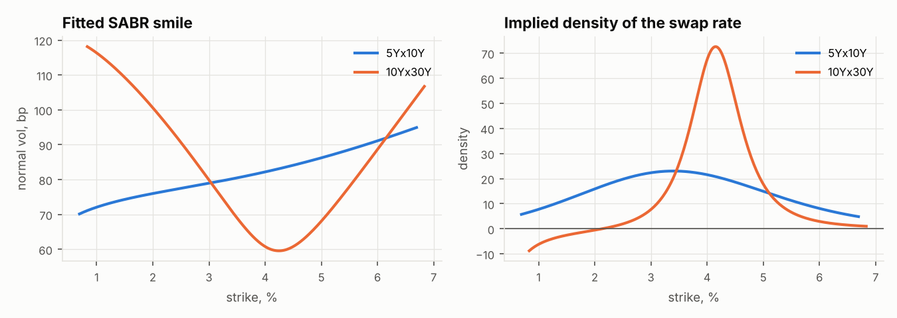
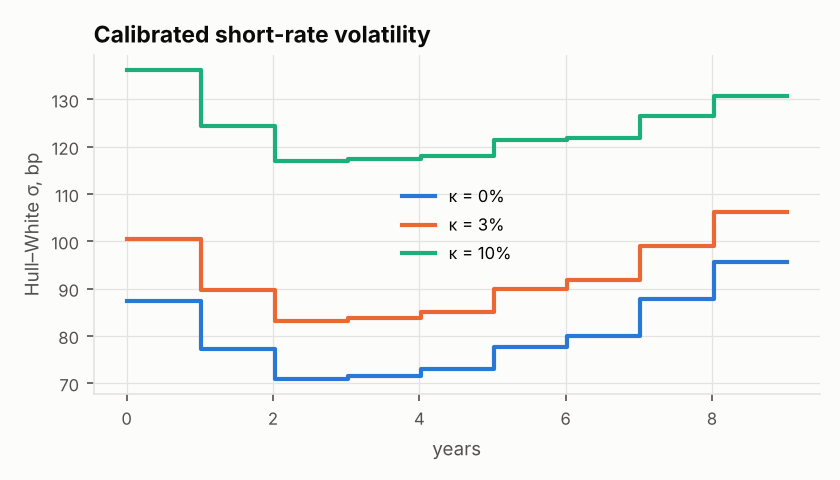
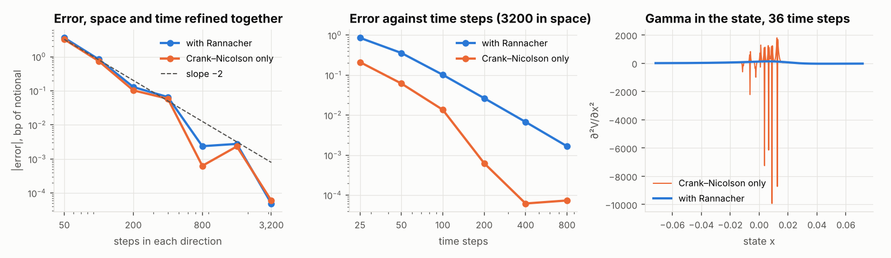
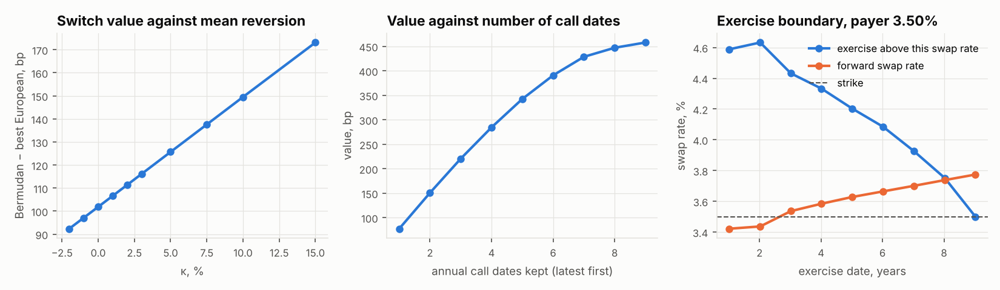
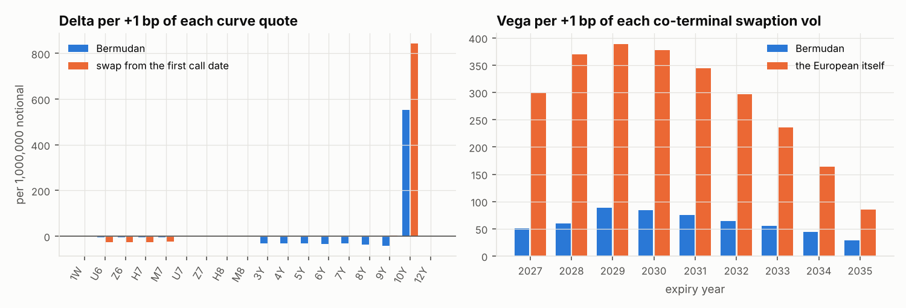
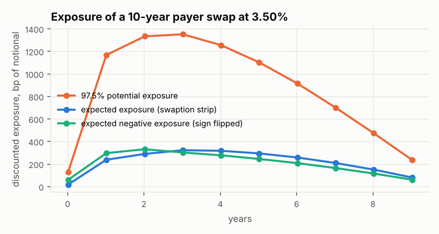
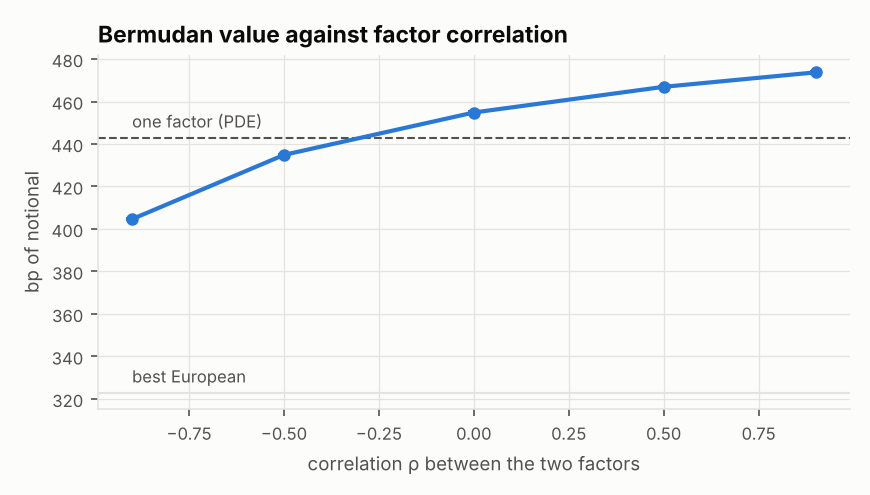
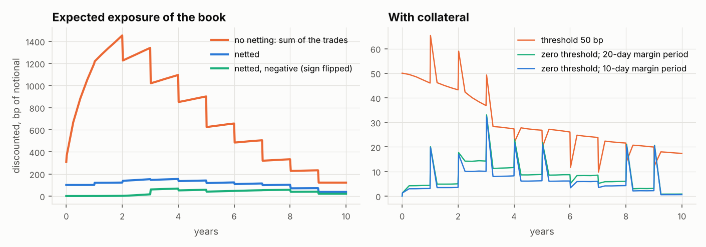
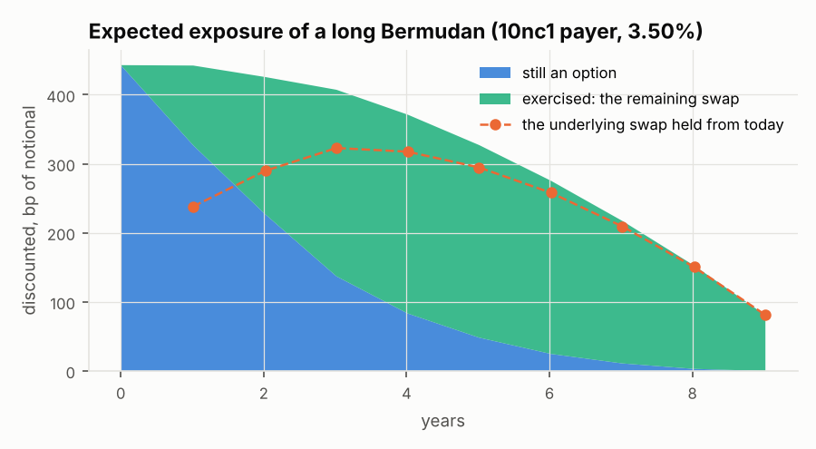

# Results

Everything here is produced by `rl_analysis` (C++) and rendered by `tools/make_results.py`; nothing is typed
in by hand. Market: USD, as of 2026-09-04, from the files in `data/` (the curve quotes and the vol screen are
synthetic but realistic). Prices are in basis points of notional unless stated.

Timings: Intel(R) Xeon(R) Processor @ 2.10GHz, 4 logical cores, Linux x86_64, single-threaded, GCC -O2.

To regenerate:

```bash
cmake -S . -B build/dev -G Ninja -DCMAKE_BUILD_TYPE=Release && cmake --build build/dev
```

```bash
uv run python tools/make_results.py
```

## 1. Curves: USD SOFR and Fed Funds, bootstrapped together

**Product view.** 37 instruments define two curves: SOFR overnight-index swaps and 3-month SOFR futures for
the SOFR curve, Fed Funds–SOFR basis swaps and Fed Funds swaps for the Fed Funds curve. The 25- and 30-year
SOFR points are quoted only through basis swaps, so the SOFR long end depends on the Fed Funds curve while
Fed Funds cashflows are discounted on SOFR. Neither curve can be built before the other.

| Interpolation | Method | Newton iterations | Worst residual (bp) | Worst instrument | Time (ms) |
| --- | --- | ---: | ---: | --- | ---: |
| linear_logdf | global Newton (adjoint Jacobian) | 4 | 4.7e-11 | SOFR-OIS-1W | 4.7 |
| linear_logdf | global Newton (finite-difference Jacobian) | 4 | 6.7e-11 | SOFR-OIS-1W | 39.6 |
| linear_logdf | sequential (one pass curve by curve) | 5 | 5.0e+00 | FF-SOFR-25Y | 5.4 |
| monotone_convex | global Newton (adjoint Jacobian) | 4 | 6.4e-11 | FF-SOFR-30Y | 11.2 |
| monotone_convex | global Newton (finite-difference Jacobian) | 4 | 4.7e-11 | SOFR-OIS-1W | 57.5 |
| monotone_convex | sequential (one pass curve by curve) | 8 | 5.0e+00 | FF-SOFR-25Y | 20.2 |

- The global solve reprices every instrument to about 1e-10 bp in four iterations under both interpolations
  (worst residuals: linear_logdf 4.7e-11 bp, monotone_convex 6.4e-11 bp).
- One pass of the curve-by-curve bootstrap leaves the long basis swaps about 5 bp off, because they were
  solved against a Fed Funds curve that did not exist yet.
- The Jacobian is taken by an adjoint sweep through the same pricing code the solver runs. It gives the same
  answer as finite differences about ten times faster, and stays exact under monotone convex interpolation,
  where a hand-derived Jacobian is easy to get subtly wrong.


*Interpolation is a modelling choice, not a detail.* Linear interpolation of log discount factors gives
piecewise-constant forwards with a jump at every pillar; monotone convex gives continuous forwards. Both
reprice the same quotes exactly. They differ in the forward rate between pillars, which is what a
forward-starting swap or a futures strip is priced on.

## 2. Swap risk: adjoint differentiation against bumping

**Product view.** A swap desk hedges with the instruments the curve is built from, so risk is reported per
par quote: "how much does the book move if the 10-year swap rate rises 1 bp and the curve is rebuilt".

A book of 200 swaps (1–30 years, both directions), delta to all 37 curve quotes:

| Method | Time (ms) | Relative to one valuation |
| --- | ---: | ---: |
| one valuation of the book | 0.38 | 1× |
| adjoint + implicit-function theorem | 2.23 | 6× |
| bump and re-bootstrap each quote | 184.48 | 485× |

- Adjoint: one reverse sweep gives the sensitivity to every curve node; one transposed linear solve with the
  bootstrap Jacobian (implicit-function theorem) converts node risk to par-quote risk. **83× faster**
  than bumping here, and the cost does not grow with the number of quotes.
- The two agree to 1e-05 of the largest delta when the bump is small (0.01 bp). A 1 bp bump differs
  by about 1e-3 because it also contains the gamma.

Largest deltas (currency units per +1 bp, notionals 1–5 million):

| Quote | Adjoint | Bump 1 bp | Bump 0.01 bp |
| --- | ---: | ---: | ---: |
| FF-SOFR-30Y | 101,850.4 | 101,870.0 | 101,850.6 |
| FF-OIS-30Y | 101,646.9 | 101,700.3 | 101,647.5 |
| SOFR-OIS-15Y | 54,407.3 | 54,432.0 | 54,407.5 |
| FF-OIS-25Y | 40,055.8 | 40,157.6 | 40,056.9 |
| FF-SOFR-25Y | 39,754.5 | 39,789.3 | 39,754.9 |
| SOFR-OIS-12Y | 27,846.4 | 27,846.8 | 27,846.4 |
| SOFR-OIS-9Y | 26,686.6 | 26,684.5 | 26,686.6 |
| SOFR-OIS-7Y | -17,807.6 | -17,793.6 | -17,807.5 |

The long-dated risk lands on `FF-OIS-30Y` and `FF-SOFR-30Y`, not on a SOFR swap: there is no 30-year SOFR
swap in the curve, so those two instruments together *are* the 30-year SOFR point. A ladder that showed
"30-year SOFR" would be showing an instrument nobody can trade.

## 3. Volatility: the swaption cube

**Product view.** A European swaption is quoted as a normal (Bachelier) vol of the forward swap rate. The
cube holds one SABR smile per (expiry, tenor): α sets the level, ρ the skew, ν the curvature, with β = 0.5
fixed as policy. α is re-solved from the at-the-money quote at every step of the fit, so every node reprices
its ATM vol exactly and only ρ and ν are searched.

- All 81 nodes fit with no parameter on a bound. Worst residual 0.016 bp
  (3Mx30Y); the quotes are rounded to 0.01 bp, so this is the rounding of the input.
- 3–5 solver iterations per node, from a starting point computed from the smile's
  skew and curvature at the money.
- Normal ↔ shifted-lognormal conversion round-trips to 1e-12. Normal → lognormal can fail (a lognormal price
  is bounded, a normal one is not) and that is reported rather than clamped.

**Where the model breaks.** Hagan's formula is an expansion, not a model: far enough below the forward its
implied density goes negative, which is a butterfly arbitrage. 50 of the 81 nodes have a
negative density somewhere inside four standard deviations. The first few, by expiry:

| Node | Forward % | ATM vol (bp) | ρ | ν | Fit residual (bp) | Density < 0 below strike % |
| --- | ---: | ---: | ---: | ---: | ---: | ---: |
| 1Yx1Y | 3.3252 | 98.35 | -0.0991 | 0.4628 | 0.0041 | 0.046 |
| 1Yx2Y | 3.3843 | 95.81 | -0.1034 | 0.4510 | 0.0030 | 0.028 |
| 1Yx3Y | 3.4297 | 93.86 | -0.1072 | 0.4412 | 0.0017 | 0.027 |
| 1Yx5Y | 3.4961 | 91.16 | -0.1139 | 0.4269 | 0.0036 | 0.027 |
| 1Yx7Y | 3.5442 | 89.47 | -0.1193 | 0.4173 | 0.0046 | 0.027 |
| 2Yx1Y | 3.3726 | 92.94 | -0.1332 | 0.3398 | 0.0035 | 0.053 |
| 2Yx2Y | 3.4292 | 90.40 | -0.1380 | 0.3282 | 0.0034 | 0.052 |
| 2Yx3Y | 3.4724 | 88.45 | -0.1415 | 0.3185 | 0.0029 | 0.052 |
| 2Yx5Y | 3.5348 | 85.75 | -0.1485 | 0.3036 | 0.0037 | 0.030 |
| 2Yx7Y | 3.5796 | 84.06 | -0.1538 | 0.2943 | 0.0032 | 0.030 |
| 2Yx10Y | 3.6295 | 82.59 | -0.1606 | 0.2850 | 0.0052 | 0.030 |
| 2Yx15Y | 3.6866 | 81.45 | -0.1675 | 0.2784 | 0.0047 | 0.030 |



The fit residual says nothing about this: the stressed 10Y×30Y node fits its seven quotes as well as any
other. The check has to be made on the density. It matters for anything that integrates the smile over
strikes (CMS, digitals), and it bounds how far from the money the cube should be read.

## 4. Model: LGM one-factor (Hull–White), calibrated to the co-terminal strip

**Model view.** One Gaussian factor. In the LGM parameterisation the model is two functions: H(t), fixed by
the mean reversion κ, and ζ(t), the variance of the state. A swaption expiring at t depends on ζ only
through ζ(t), so the nine co-terminal swaptions of the 10-year callable swap pin ζ one point at a time by a
1-D root search. The strike is the trade's own (3.50%), read off the smile.

Calibration at κ = 3%:

| Expiry date | Expiry (y) | Tenor (y) | Forward % | Market vol (bp) | Model vol (bp) | Error (bp) | σ (bp) |
| --- | ---: | ---: | ---: | ---: | ---: | ---: | ---: |
| 2027-09-09 | 1.01 | 9.0 | 3.4216 | 88.67 | 88.67 | 3e-13 | 100.5 |
| 2028-09-11 | 2.02 | 8.0 | 3.4364 | 83.71 | 83.71 | 3e-13 | 89.7 |
| 2029-09-10 | 3.02 | 7.0 | 3.5361 | 80.30 | 80.30 | -5e-13 | 83.1 |
| 2030-09-09 | 4.02 | 6.0 | 3.5842 | 78.61 | 78.61 | -4e-13 | 83.7 |
| 2031-09-09 | 5.02 | 5.0 | 3.6280 | 77.86 | 77.86 | 2e-13 | 85.1 |
| 2032-09-09 | 6.02 | 4.0 | 3.6643 | 78.16 | 78.16 | -9e-14 | 89.8 |
| 2033-09-09 | 7.02 | 3.0 | 3.7005 | 78.73 | 78.73 | 6e-13 | 91.9 |
| 2034-09-11 | 8.02 | 2.0 | 3.7378 | 80.22 | 80.22 | 4e-13 | 99.1 |
| 2035-09-10 | 9.02 | 1.0 | 3.7739 | 82.38 | 82.38 | 3e-13 | 106.3 |

Worst repricing error over κ = 0%, 3%, 10%: 1e-12 bp.



*The strip does not identify κ.* All three models reprice the same nine swaptions; they differ in how much
short-rate volatility is needed to do it. Higher κ makes long-dated rates less sensitive to the state, so σ
must rise to keep the same swaption vols. What κ changes is the correlation of rates *across* exercise
dates, which the Europeans cannot see and the Bermudan can (section 6).

## 5. Product: the Bermudan swaption, priced three ways

**Product view.** A 10-year fixed-for-SOFR swap that one side may enter on any of nine annual dates from
year 1 ("10 non-call 1"). On each date the holder compares the value of entering the remaining swap with
the value of keeping the option. Prices are in basis points of notional; κ = 3%.

| Trade | Best European | Lower bound (LSMC) | PDE | Upper bound (A–B) | Duality gap | P(exercise) |
| --- | ---: | ---: | ---: | ---: | ---: | ---: |
| 10nc1 payer 2.50% (ITM) | 738.8 | 851.60 ± 0.14 | 851.42 | 852.33 ± 0.17 | 0.73 ± 0.08 | 91% |
| 10nc1 payer 3.50% (near ATM) | 322.8 | 442.91 ± 0.11 | 442.88 | 443.35 ± 0.12 | 0.43 ± 0.05 | 76% |
| 10nc1 payer 4.50% (OTM) | 144.6 | 222.99 ± 0.10 | 222.98 | 223.17 ± 0.11 | 0.18 ± 0.03 | 59% |
| 10nc1 receiver 3.50% | 331.4 | 431.74 ± 0.16 | 431.91 | 432.29 ± 0.18 | 0.55 ± 0.07 | 61% |

- **Lower bound.** Longstaff–Schwartz: fit an exercise rule by regression on 20,000 paths, then value that
  rule on 4 million independent paths. Any rule is a strategy the holder could follow, so it cannot be
  worth more than the option.
- **Upper bound.** Andersen–Broadie: the dual formulation, with the martingale built from the same rule by
  nested simulation (2,000 outer × 500 inner paths).
- **PDE.** Crank–Nicolson on a 1600 × 1600 grid, converged to about 0.003 bp, and confirmed to 0.001 bp
  by an independent backward induction that integrates against the exact Gaussian transition density.
- The three agree on every trade: the PDE lies within two standard errors of both bounds (the largest
  excursion is 1.3 standard errors), and the duality gap, which is measured much more precisely
  than either bound, is
  0.2–0.7 bp, about 0.1% of the price.
- The Bermudan is worth far more than its best single European: the right to choose the date is a large
  part of the value, more so out of the money.

Wall-clock per pricing (PDE at 400 × 400, which is already within 0.05 bp):

| Trade | PDE (ms) | LSMC, 4M paths (ms) | Upper bound (ms) |
| --- | ---: | ---: | ---: |
| 10nc1 payer 2.50% (ITM) | 2.3 | 1745 | 1613 |
| 10nc1 payer 3.50% (near ATM) | 2.3 | 2446 | 2119 |
| 10nc1 payer 4.50% (OTM) | 2.3 | 2645 | 2871 |
| 10nc1 receiver 3.50% | 2.3 | 2491 | 2437 |

### 5.1 PDE: what converges, and what Rannacher start-up actually buys

Under LGM the deflated value satisfies the heat equation in the variance clock ζ, with no drift or
discounting terms: the change of numeraire has absorbed them.

| Steps (space = time) | Error with Rannacher (bp) | Error, Crank–Nicolson only (bp) | Time (ms) |
| --- | ---: | ---: | ---: |
| 50 | 4.9e+00 | 4.4e+00 | 0.07 |
| 100 | 4.4e-01 | 3.1e-01 | 0.21 |
| 200 | 4.1e-01 | 3.8e-01 | 0.67 |
| 400 | 4.8e-02 | 3.8e-02 | 2.28 |
| 800 | 5.0e-03 | 2.7e-03 | 8.47 |
| 1600 | 3.7e-03 | 3.1e-03 | 33.10 |
| 3200 | 5.0e-04 | 3.5e-04 | 134.06 |



- **Second order overall, not monotone.** The error falls 10,000-fold over a 64-fold refinement, but
  unevenly: it depends on where the exercise boundary falls between grid nodes, so one doubling can do
  nothing and the next cut the error sixteen-fold. Convergence has to be judged over several doublings.
- **Rannacher start-up costs price accuracy here.** The textbook advice is to replace the first steps after
  each exercise date with implicit ones, to damp the oscillations Crank–Nicolson would otherwise carry. For
  this payoff the price is *more* accurate without it (middle panel): exercising creates a kink, not a
  jump, and the implicit steps bring their own time-stepping error.
- **It buys smooth greeks.** With few time steps on a fine space grid, the second derivative from plain
  Crank–Nicolson oscillates; with the start-up it does not (right panel). It is on by default because the
  output is hedged, not just quoted.

### 5.2 Monte Carlo: the exercise rule, the bias, the error

PDE reference 442.88 bp.

| Regressors | Degree | Lower bound (bp) | Duality gap (bp) |
| --- | ---: | ---: | ---: |
| state | 0 | 433.55 ± 0.36 | 9.90 ± 0.44 |
| state | 1 | 441.94 ± 0.36 | 0.76 ± 0.08 |
| state | 2 | 442.22 ± 0.36 | 0.49 ± 0.06 |
| state | 3 | 442.30 ± 0.35 | 0.39 ± 0.05 |
| state | 4 | 442.31 ± 0.35 | 0.42 ± 0.06 |
| state | 6 | 442.31 ± 0.35 | 0.47 ± 0.06 |
| exercise value | 0 | 433.55 ± 0.36 | 9.90 ± 0.44 |
| exercise value | 1 | 441.23 ± 0.36 | 1.46 ± 0.13 |
| exercise value | 2 | 442.27 ± 0.36 | 0.41 ± 0.06 |
| exercise value | 3 | 442.31 ± 0.35 | 0.43 ± 0.05 |
| exercise value | 4 | 442.30 ± 0.35 | 0.41 ± 0.06 |
| exercise value | 6 | 442.33 ± 0.35 | 0.44 ± 0.05 |


- **Degree 0** (continuation value = a constant, so the rule cannot see the state) loses about 9 bp, and
  the gap shows it without needing the PDE: the gap is a model-free measure of how good the rule is.
- **Degree 1–2 is already enough** in a one-factor model; beyond degree 3 nothing improves. Regressing on
  the swap's value works as well as regressing on the state, and is the choice that carries over to models
  with more factors.
- **In-sample bias.** Valuing the rule on its own training paths overstates the price, by about
  15 bp with 250 paths; on fresh paths
  the same rule is *below* the true price, as a lower bound must be. The two meet as the training set grows.
  (Averages over 200 seeds.)
- **Error** falls as 1/√N; antithetic paths cut it by 1.8×, the equivalent of 3.1× the paths.

## 6. What drives the Bermudan: model and product behaviour



**Mean reversion.** The calibration swaptions do not move with κ; the Bermudan does.

| κ | Bermudan (bp) | Best European (bp) | Switch value (bp) |
| --- | ---: | ---: | ---: |
| -2.0% | 420.5 | 322.8 | 97.6 |
| -1.0% | 424.9 | 322.8 | 102.1 |
| 0.0% | 429.4 | 322.8 | 106.5 |
| 1.0% | 433.9 | 322.8 | 111.0 |
| 2.0% | 438.4 | 322.8 | 115.5 |
| 3.0% | 442.9 | 322.8 | 120.0 |
| 5.0% | 451.9 | 322.8 | 129.0 |
| 7.5% | 463.1 | 322.8 | 140.3 |
| 10.0% | 474.4 | 322.8 | 151.6 |
| 15.0% | 496.7 | 322.8 | 173.8 |

From κ = -2% to 15% the switch value goes from 98 to
174 bp with every calibration instrument repriced exactly throughout. Higher κ
means a shock today has decayed by the later exercise dates, so the exercise decisions are less correlated
and the right to choose among them is worth more. κ is the number a Bermudan desk marks, and this table is
its price.

**Exercise rights.** Value is non-decreasing in the set of call dates, by construction of the product; the
middle panel adds the nine dates one at a time from the last.

**Exercise boundary** (payer, strike 3.50%):

| Call date | Forward swap rate % | European (bp) | Exercise if swap rate above % | P(exercise here) |
| --- | ---: | ---: | ---: | ---: |
| 2027-09-09 | 3.4216 | 238.2 | 4.5438 | 11.7% |
| 2028-09-11 | 3.4364 | 289.8 | 4.5935 | 11.2% |
| 2029-09-10 | 3.5361 | 322.8 | 4.4224 | 12.3% |
| 2030-09-09 | 3.5842 | 317.6 | 4.3413 | 8.4% |
| 2031-09-09 | 3.6280 | 294.7 | 4.2527 | 7.7% |
| 2032-09-09 | 3.6643 | 258.2 | 4.1414 | 6.9% |
| 2033-09-09 | 3.7005 | 209.4 | 4.0076 | 6.1% |
| 2034-09-11 | 3.7378 | 150.4 | 3.8103 | 6.2% |
| 2035-09-10 | 3.7739 | 81.1 | 3.5000 | 5.8% |

At the last date the boundary is the strike: nothing is left to wait for. Earlier, the swap must be in the
money by a margin, about 100 bp at the first call date, because exercising gives up the remaining
optionality.

## 7. Bermudan risk

Notional 1,000,000, payer 3.50%, κ = 3%. Each number is a full revaluation: bump the market, re-bootstrap
the curve, **re-calibrate the model**, reprice by PDE. Re-calibrating is the point: the hedge instruments
are the co-terminal swaptions, and the model has to keep repricing them after the bump.



**Delta.** Total 285 per bp against 748 for the swap from the first call date: the option's delta
is about 38% of the underlying's.

| Quote | Bermudan | Forward swap |
| --- | ---: | ---: |
| SR3-U6 | -4.9 | -25.0 |
| SR3-Z6 | -4.9 | -25.0 |
| SR3-H7 | -4.9 | -25.0 |
| SR3-M7 | -4.7 | -23.3 |
| SOFR-OIS-3Y | -31.2 | 0.2 |
| SOFR-OIS-4Y | -31.7 | 0.2 |
| SOFR-OIS-5Y | -30.8 | 0.1 |
| SOFR-OIS-6Y | -32.8 | 0.3 |
| SOFR-OIS-7Y | -32.6 | 0.5 |
| SOFR-OIS-8Y | -37.2 | -0.1 |
| SOFR-OIS-9Y | -42.5 | 2.7 |
| SOFR-OIS-10Y | 552.9 | 844.2 |

The swap's delta is one long bucket at 10 years and a short at its 1-year start. The Bermudan has the same
long end and a *short in every intermediate year*: it is a probability-weighted mix of swaps starting in
years 1 to 9, each of which is long the 10-year rate and short the rate to its own start date. No risk
appears beyond 10 years or on the Fed Funds basis.

**Vega**, by calibration instrument:

| Expiry | Bermudan vega | European's own vega | Ratio |
| --- | ---: | ---: | ---: |
| 2027-09-09 | 51.2 | 299.5 | 17% |
| 2028-09-11 | 59.9 | 370.0 | 16% |
| 2029-09-10 | 89.0 | 389.1 | 23% |
| 2030-09-09 | 83.9 | 377.6 | 22% |
| 2031-09-09 | 75.0 | 344.8 | 22% |
| 2032-09-09 | 63.7 | 296.2 | 22% |
| 2033-09-09 | 54.8 | 235.3 | 23% |
| 2034-09-11 | 44.2 | 164.1 | 27% |
| 2035-09-10 | 28.4 | 85.4 | 33% |

Total 550 against 2562 for holding all nine Europeans. Each ratio is roughly the hedge ratio in that
European; they are all well below one because the Bermudan is one option on the best of nine, not nine
options.

## 8. Exposure: the same model, seen from counterparty risk

The expected positive exposure of a swap at a future date is E[max(V, 0)], which is by definition the price
of a European swaption on the remaining swap. A swap's exposure profile is a strip of co-terminal
swaptions: the same instruments the Bermudan is calibrated to. So with this calibration the profile below
is not a model output at all from year 1 on. It is the market's swaption prices.

| Years | EE, closed form (bp) | EE, Monte Carlo (bp) | PFE 97.5% (bp) | ENE (bp) |
| --- | ---: | ---: | ---: | ---: |
| 0.01 | 18.0 | 18.0 ± 0.2 | 130 | -60.3 |
| 1.01 | 238.2 | 237.2 ± 1.6 | 1168 | -296.9 |
| 2.02 | 289.8 | 286.2 ± 1.8 | 1334 | -331.4 |
| 3.02 | 322.8 | 325.4 ± 1.9 | 1351 | -302.5 |
| 4.02 | 317.6 | 316.4 ± 1.7 | 1255 | -277.8 |
| 5.02 | 294.7 | 291.1 ± 1.6 | 1103 | -245.2 |
| 6.02 | 258.2 | 259.1 ± 1.3 | 915 | -208.3 |
| 7.02 | 209.4 | 209.5 ± 1.0 | 701 | -164.5 |
| 8.03 | 150.4 | 150.7 ± 0.7 | 473 | -115.7 |
| 9.02 | 81.1 | 81.6 ± 0.4 | 237 | -61.4 |



- The closed form and a 50,000-path simulation agree within sampling error at every date, which is how an
  exposure engine can be validated against a pricing model.
- The hump is diffusion against amortisation: rate uncertainty grows with time while the remaining annuity
  shrinks.
- CVA on this swap is this strip weighted by default probabilities. The right to cancel the swap is the
  Bermudan of section 5 on the offsetting swap. The exposure world and the exotics world are pricing the
  same options.

Not modelled: collateral, netting, margin period of risk, wrong-way risk.

## 9. A second factor: G2++

**Model view.** One factor moves every rate together. G2++ has two Gaussian factors with different mean
reversions and a correlation ρ between them, so the curve can steepen and flatten as well as shift. It is
written here in the same deflated-bond form as the one-factor model: the state is driftless, the curve is
fitted by construction, and Monte Carlo steps are exact. A common volatility scale s(t) carries the level;
the two speeds, the volatility ratio and ρ carry the shape.

### 9.1 European swaptions: one closed form and a one-dimensional integral

With two states there is no single exercise point, so Jamshidian's decomposition does not apply directly.
Conditioning on one direction of the state brings it back: the inner expectation is a closed form and the
outer integral is one-dimensional. Price of a 5Y×10Y payer against two-dimensional numerical integration:

| Gauss–Hermite points | Price (bp) | Error (bp) | Time (µs) |
| ---: | ---: | ---: | ---: |
| 2 | 423.540144 | 3e-06 | 6 |
| 4 | 423.540146 | 3e-08 | 10 |
| 8 | 423.540146 | 3e-08 | 22 |
| 16 | 423.540146 | 3e-08 | 44 |
| 24 | 423.540146 | 3e-08 | 65 |

Four points already give the price to 3e-08 bp. That is a consequence of the direction chosen for the
closed form. Brigo and Mercurio condition on the first factor; that is exact, but when the factors are
highly correlated the remaining integrand tends to the kinked payoff and the quadrature stops converging.
Taking the closed form along the direction that decides exercise leaves an integrand that is almost flat,
and exactly constant in the one-factor limit. The tests check the formula against their bond-option
formula, against two-dimensional integration, and against the one-factor model when the second factor is
switched off.

### 9.2 Shape from the ATM matrix: what the second factor buys here, and what it does not

Both models are fitted to 30 ATM swaptions (expiries 1Y–10Y, tenors 1Y–20Y) with the same freedom in the
level: one volatility scale per expiry row. What is left to explain is the tenor direction, which is where
a second factor can help. The two-factor fit is run from four starting points.

| Model | Start | κ₁ | κ₂ | σ₂/σ₁ | ρ | RMS error (bp) | Worst (bp) | Corr(1Y, 10Y fwd) |
| --- | --- | ---: | ---: | ---: | ---: | ---: | ---: | ---: |
| one factor |  | 1.7% |  |  |  | 1.85 | 2.87 | 1.000 |
| two factors | κ₁ 0.1 ρ -0.9 | 9.4% | 0.1% | 1.13 | -0.04 | 1.57 | 3.76 | 0.938 |
| two factors | κ₁ 0.1 ρ 0.5 | 3.4% | 0.1% | 0.76 | +0.10 | 1.75 | 3.39 | 0.991 |
| two factors | κ₁ 0.6 ρ -0.9 | 150.0% | 1.5% | 0.69 | -0.01 | 1.66 | 3.45 | 0.950 |
| two factors | κ₁ 0.6 ρ 0.5 | 15.5% | 0.1% | 1.85 | +0.49 | 1.50 | 3.57 | 0.975 |

Fit errors in bp of normal vol, one factor / two factors (best start), by expiry (rows) and tenor (columns):

| Expiry | 1Y | 2Y | 5Y | 10Y | 20Y |
| --- | ---: | ---: | ---: | ---: | ---: |
| 1Y | -1.5 / +0.8 | +0.1 / +1.3 | +2.3 / +1.4 | +1.7 / -0.4 | -2.9 / -3.6 |
| 2Y | -2.0 / -0.4 | -0.2 / +0.6 | +2.3 / +1.4 | +2.0 / +0.3 | -2.2 / -2.2 |
| 3Y | -2.1 / -1.0 | -0.3 / +0.1 | +2.2 / +1.4 | +2.0 / +0.7 | -1.8 / -1.4 |
| 5Y | -2.3 / -1.8 | -0.5 / -0.5 | +2.1 / +1.3 | +2.1 / +1.3 | -1.4 / -0.2 |
| 7Y | -2.5 / -2.4 | -0.6 / -1.0 | +2.0 / +1.2 | +2.2 / +1.7 | -1.0 / +0.8 |
| 10Y | -2.6 / -3.0 | -0.7 / -1.3 | +2.0 / +1.2 | +2.1 / +2.0 | -0.7 / +1.8 |

- The second factor improves the fit from 1.85 bp to 1.50 bp. That is a small gain for three extra
  parameters.
- **The shape is not identified by this matrix.** The four starts end at RMS errors between 1.50 and
  1.75 bp with different parameters, a forward-rate correlation anywhere from 0.94 to 0.99,
  and a bound active every time (κ1, κ2). 4 of the 4 fits stopped at the iteration limit: the objective is flat along a valley.
- The one-factor residuals have the same signs on every row: too low at the 1Y and 20Y tenors, too high
  in between. That is a tenor shape one mean reversion cannot produce. The second factor removes part of
  it at the short expiries and none of it at the long ones.
- The vol screen is synthetic: it was generated from smooth SABR surfaces, not from a correlation
  structure. Published calibrations to market data typically find ρ strongly negative; this matrix carries
  no such information, and the fit says so instead of returning a confident number.

### 9.3 The Bermudan: the same Europeans, a different correlation

Holding the shape fixed, the volatility scale is bootstrapped to the co-terminal strip of the 10nc1 payer
at 3.50%, one expiry at a time, exactly as ζ is in the one-factor model. Every model below reprices the
nine Europeans (worst error 1e-12 bp of vol). They differ only in how rates on different exercise dates
are correlated. Prices are Longstaff–Schwartz lower bounds on one million paths, regressing on both states.

| Model | ρ | Corr(1Y, 10Y fwd) | Bermudan (bp) | Switch value (bp) | Strip error (bp) |
| --- | ---: | ---: | ---: | ---: | ---: |
| One factor, PDE |  | 1.000 | 442.87 | 120.0 | 6.1e-13 |
| Two-factor code, second factor off |  | 1.000 | 442.82 ± 0.30 | 120.0 | 1.0e-12 |
| Fast second factor | +0.9 | 0.985 | 473.72 ± 0.31 | 150.9 | 4.0e-13 |
| Fast second factor | +0.5 | 0.922 | 466.91 ± 0.31 | 144.1 | 4.1e-13 |
| Fast second factor | +0.0 | 0.837 | 454.82 ± 0.31 | 132.0 | 4.3e-13 |
| Fast second factor | -0.5 | 0.753 | 434.87 ± 0.30 | 112.0 | 5.5e-13 |
| Fast second factor | -0.9 | 0.789 | 404.62 ± 0.30 | 81.8 | 8.7e-13 |
| Shape fitted to the ATM matrix | +0.49 | 0.975 | 441.27 ± 0.30 | 118.4 | 3.1e-13 |



- **The pricer is validated where the answer is known.** With the second factor switched off the two-factor
  Monte Carlo gives 442.82 ± 0.30 bp against the one-factor PDE's 442.87 bp.
- **Correlation moves the Bermudan by 69 bp** (from 404.6 to 473.7 bp as ρ goes from −0.9 to +0.9)
  while every calibration instrument stays repriced. That is the same order as the effect of mean reversion
  in section 6, and for the same reason: the Europeans fix the variance of each swap rate on its own
  exercise date and say nothing about how the rates on different dates move together.
- **Which correlation matters.** The prices are not ordered by the correlation between forward rates of
  different maturities (third column): the highest price has the highest such correlation. What the
  Bermudan prices is correlation across TIME, between the swap rates seen on different exercise dates. A
  fast factor's shocks have died out by the later dates. Positively correlated with the slow factor, it
  makes recent shocks count for more than old ones, which is what extra mean reversion does, and the
  switch value rises. Negatively correlated, it offsets recent shocks, acts like negative mean reversion,
  and the value falls below the one-factor price.
- With the shape fitted to the ATM matrix the Bermudan is 441.3 bp, 1.6 bp from the one-factor price.
  Given 9.2, that number is one point in a range the calibration set does not narrow. A desk closes it
  with instruments that see correlation directly: Bermudan quotes, CMS spread options, or a second strip.

Not done: an upper bound for the two-factor price (the duality gap of the one-factor rule in section 5 was
below one basis point, and the same regression is used here on two states), and risk under the two-factor
model.

## 10. Marking the mean reversion

Sections 4 and 6 left κ as an input: the co-terminal strip is repriced at any κ, and the Bermudan moves by
tens of basis points with it. A second set of swaptions with the same expiries and a different tenor does
see κ. Given ζ(t), the model vol of a short swap starting at t scales with e^(−κt), while the co-terminal
swap's vol is held fixed by the calibration. So κ is chosen to minimise the error on the second set,
re-bootstrapping ζ to the co-terminal strip at every trial value.

| Second strip (expiries 1Y–9Y) | κ | RMS error on it (bp) | Co-terminal strip error (bp) | Bermudan (bp) |
| --- | ---: | ---: | ---: | ---: |
| 1Y | 3.48% | 1.84 | 7.5e-13 | 445.03 |
| 2Y | 2.92% | 1.24 | 8.2e-13 | 442.50 |


- The objective has a clear interior minimum: unlike the two-factor shape of section 9, κ is identified.
- The two choices of second strip give 3.48% and 2.92%, and Bermudan prices 2.5 bp apart
  (the reference κ = 3% gives 442.87 bp). That spread is what is left of the 76 bp range of section 6
  once κ is marked.
- One number cannot reprice nine instruments. The errors on the 1Y-tenor strip, by expiry, are
  +3.0, +0.8, -0.7, -1.5, -2.2, -2.2, -2.3, -1.7, -0.6 bp:
  positive at the short end and negative in the middle. That pattern is what a time-dependent mean
  reversion, or a second factor, would be fitted to.

## 11. XVA: from exposure to price

Section 8 stopped at one swap's uncollateralised exposure profile. This section prices it: a credit curve,
a netting set, collateral, a Bermudan, and the sensitivities. The model is the one-factor LGM of section 4
(κ = 3%, calibrated to the 10-year co-terminal strip). All exposures are discounted expectations of
deflated values, so CVA is exposure weighted by default probabilities with no further discounting.

### 11.1 The credit curve

Hazard rates, constant between CDS maturities, bootstrapped so that each quoted spread makes its CDS worth
zero (quarterly premiums with accrual on default, recovery 40%). The counterparty's curve:

| CDS maturity | Spread (bp) | Hazard rate on the interval (%) | Survival to maturity (%) |
| --- | ---: | ---: | ---: |
| 1Y | 80 | 1.33 | 98.7 |
| 3Y | 105 | 1.97 | 94.9 |
| 5Y | 125 | 2.66 | 89.9 |
| 7Y | 140 | 3.10 | 84.5 |
| 10Y | 150 | 3.04 | 77.2 |

Both curves reprice their quotes to machine precision. Our own curve, for DVA, is 40 bp at one year rising to
78 bp at ten. The funding spread for FVA is a flat 60 bp. The spreads are illustrative, not a market's.

### 11.2 One swap: the engine against a closed form

For a single swap the expected positive exposure on a coupon date is a European swaption on the remaining
swap, so its CVA is a strip of swaptions with no simulation error. The Monte Carlo engine, which revalues
the swap on every path, must reproduce it. 10-year payer at 3.50%, 100,000 paths:

| Years | EPE, closed form (bp) | EPE, engine (bp) | ENE, closed form (bp) | ENE, engine (bp) |
| ---: | ---: | ---: | ---: | ---: |
| 1.01 | 238.2 | 237.9 ± 1.1 | -296.9 | -295.7 |
| 2.02 | 289.8 | 288.9 ± 1.3 | -331.4 | -331.8 |
| 3.02 | 322.8 | 322.4 ± 1.3 | -302.5 | -303.4 |
| 4.02 | 317.6 | 316.8 ± 1.2 | -277.8 | -278.5 |
| 5.02 | 294.7 | 293.8 ± 1.1 | -245.2 | -247.1 |
| 6.02 | 258.2 | 257.0 ± 0.9 | -208.3 | -209.6 |
| 7.02 | 209.4 | 208.4 ± 0.7 | -164.5 | -164.5 |
| 8.03 | 150.4 | 149.8 ± 0.5 | -115.7 | -115.9 |
| 9.02 | 81.1 | 80.9 ± 0.3 | -61.4 | -61.6 |

| Method | CVA (bp) | DVA (bp) | FCA (bp) | FBA (bp) |
| --- | ---: | ---: | ---: | ---: |
| closed form | 29.55 | 14.54 | 12.80 | 12.04 |
| Monte Carlo | 29.46 | 14.57 | 12.76 | 12.06 |

CVA is the expected loss if the counterparty defaults while owing us; DVA is the mirror image on our own
default; FCA and FBA are the cost and benefit of funding the uncollateralised asset and liability at our
spread. Payer and receiver are each other's mirror: one side's CVA exposure is the other's DVA exposure,
which is tested.

### 11.3 A netting set

Eight swaps with one counterparty (values today in bp of a unit notional; the book is worth +100.1 bp):

| Trade | Tenor | Fixed rate % | Side | Notional | Value (bp) |
| ---: | ---: | ---: | --- | ---: | ---: |
| 1 | 10Y | 3.50 | pay fixed | 1.0 | -42.3 |
| 2 | 7Y | 3.40 | receive fixed | 0.8 | +19.9 |
| 3 | 5Y | 3.60 | pay fixed | 1.2 | -165.3 |
| 4 | 3Y | 3.30 | receive fixed | 1.5 | +8.5 |
| 5 | 2Y | 3.50 | pay fixed | 1.0 | -0.8 |
| 6 | 10Y | 3.70 | receive fixed | 0.6 | +126.9 |
| 7 | 7Y | 3.20 | pay fixed | 0.5 | +49.8 |
| 8 | 5Y | 3.55 | receive fixed | 0.9 | +103.3 |

Exposure is simulated on 51 dates (quarterly, plus every coupon date) with 50,000 paths; one run takes
1.9 s.



| Agreement | CVA (bp) | DVA (bp) | FCA (bp) | FBA (bp) |
| --- | ---: | ---: | ---: | ---: |
| No netting agreement | 93.91 | — | 43.32 | — |
| Netted; no collateral | 14.95 | 2.77 | 6.57 | 2.01 |
| Zero threshold; 10-day margin period | 0.89 | 0.58 | 0.38 | 0.44 |
| Threshold 50 bp of notional | 3.89 | 0.88 | 1.81 | 0.64 |
| Minimum transfer 10 bp | 0.89 | 0.58 | 0.38 | 0.45 |
| Zero threshold; 20-day margin period | 1.15 | 0.72 | 0.49 | 0.56 |

- **Netting cuts CVA from 93.9 to 14.9 bp**, a factor of 6.3. Without a netting agreement each trade is a
  separate claim and the offsetting payers and receivers both count; with one, only the net does.
- **Collateral with a zero threshold cuts it again to 0.89 bp, and not to zero.** What is left is the
  move of the book over the 10-day margin period of risk, during which no more collateral arrives.
  Doubling the period raises CVA by a factor of 1.30. A pure diffusion would give √2 = 1.41; the rest is
  the coupon effect below, which does not scale with the period.
- **A threshold is uncollateralised exposure by design:** 50 bp of notional leaves 3.89 bp of CVA.
- **A minimum transfer amount barely matters** (0.89 against 0.89 bp). A call that is not made leaves a
  small value uncollateralised in both directions, so to first order it adds as much as it removes.
- **Collateralised exposure spikes on coupon dates.** Away from them the residual exposure averages
  4.9 bp; on them, 17.7 bp. When a coupon rolls off, the book's value jumps by the net
  coupon while the collateral held was called on the value before it. This is the part of collateralised
  exposure a diffusion-only argument misses.

### 11.4 The Bermudan: an option that turns into a swap

A swap's future value is a known function of the state. A Bermudan's is not: on each path it is either
still an option, worth the larger of exercise and continuation, or it has been exercised and the holder
owns the remaining swap. The continuation value is computed as a function of the state at every exercise
date by backward induction with exact Gaussian transitions, and paths are then exercised optimally.

The same simulation reproduces the price: 442.87 bp from the grid and 441.09 ± 0.89 bp from the
paths, against 442.87 bp from the PDE of section 5.

| Years | EPE (bp) | of which option | of which swap | ENE (bp) | Exercised by then | Underlying swap's EPE (bp) |
| ---: | ---: | ---: | ---: | ---: | ---: | ---: |
| 0.00 | 442.9 ± 0.0 | 442.9 | 0.0 | 0.0 | 0% | 0.0 |
| 1.01 | 442.3 ± 0.6 | 326.8 | 115.5 | 0.0 | 11% | 238.2 |
| 2.02 | 425.6 ± 0.8 | 227.0 | 198.7 | -1.2 | 22% | 289.8 |
| 3.02 | 407.2 ± 0.8 | 137.0 | 270.1 | -3.2 | 34% | 322.8 |
| 4.02 | 371.2 ± 0.8 | 83.2 | 287.9 | -6.7 | 44% | 317.6 |
| 5.02 | 327.1 ± 0.7 | 48.3 | 278.8 | -10.6 | 51% | 294.7 |
| 6.02 | 275.5 ± 0.6 | 24.7 | 250.8 | -14.4 | 58% | 258.2 |
| 7.02 | 217.3 ± 0.5 | 11.0 | 206.4 | -16.8 | 65% | 209.4 |
| 8.03 | 152.6 ± 0.3 | 3.0 | 149.6 | -16.5 | 71% | 150.4 |
| 9.02 | 80.7 ± 0.2 | 0.0 | 80.7 | -11.5 | 76% | 81.1 |



- **Before the first exercise date the exposure is the option's price**, 443 bp, far above the
  underlying swap's exposure at the same dates. The option is an asset on every path; the swap is one on
  about half of them.
- **Exercise replaces option exposure with swap exposure.** By year 5, 51% of paths have exercised
  and 85% of the exposure is the swap's. At the last date the two profiles meet: the option is gone.
- **Negative exposure appears only after exercise**, on paths where rates fell after the holder entered
  the swap: -11.5 bp at the end, against the swap's own which is several times larger. The
  holder chose when to enter.
- **CVA of the Bermudan is 37.7 bp against 29.5 bp for the swap**, and its DVA is 0.6 bp against
  14.5 bp. Buying the option is taking more credit risk on the counterparty and giving them
  almost none in return.

Physical settlement is assumed. A cash-settled Bermudan has no exposure after exercise.

### 11.5 Sensitivities

**Credit.** Change in CVA for +1 bp on each CDS quote, re-bootstrapping the hazard curve. Exposure does
not change, so this costs nothing.

| Quote | Swap CVA (bp per bp) | Book CVA (bp per bp) |
| --- | ---: | ---: |
| CDS-1Y | -0.0176 | -0.0042 |
| CDS-3Y | -0.0183 | -0.0078 |
| CDS-5Y | +0.0135 | +0.0075 |
| CDS-7Y | +0.0951 | +0.0238 |
| CDS-10Y | +0.1022 | +0.0698 |

Parallel: +0.175 and +0.089. The short-maturity entries are negative. Raising the 1-year spread alone
moves default probability from later years, where the exposure is, to the first year, where there is
little. A CVA hedge with a single CDS maturity would get this wrong.

**Rates.** Delta of the swap's CVA to each of the 37 par quotes the curves are built from. The swaption
weights the strip was priced with are already its derivatives to each bond (the exercise boundary is
optimal, so its own sensitivity drops out), which makes CVA linear in the discount factors with known
coefficients: one tape sweep and one transposed solve with the bootstrap Jacobian.

| Quote (largest six) | Adjoint | Bump, model fixed | Bump, re-calibrated |
| --- | ---: | ---: | ---: |
| SOFR-OIS-5Y | -0.0386 | -0.0385 | -0.0367 |
| SOFR-OIS-6Y | -0.0480 | -0.0478 | -0.0462 |
| SOFR-OIS-7Y | -0.0530 | -0.0527 | -0.0521 |
| SOFR-OIS-8Y | -0.0572 | -0.0567 | -0.0574 |
| SOFR-OIS-9Y | -0.0307 | -0.0303 | -0.0342 |
| SOFR-OIS-10Y | +0.5190 | +0.5229 | +0.5080 |
| **All 37 quotes** | **+0.2265** | **+0.2320** | **+0.2209** |

|  | Time (ms) | Relative |
| --- | ---: | ---: |
| One CVA | 1.18 | 1× |
| Delta, adjoint | 1.97 | 1.7× |
| Delta, bump with the model fixed | 278 | 235× |
| Delta, bump and re-calibrate | 844 | 713× |

- The adjoint ladder is the exact derivative: the tests match it to a small central bump to 2e-10. The
  bumps in the table are one-sided 1 bp shifts and differ from it by their convexity, at most 4e-03 bp per bp.
- The adjoint costs the time of 1.7 CVA evaluations. Bumping needs 37 curve rebuilds and revaluations:
  **about 141× slower**.
- **Which delta is a choice.** Bumping with the model's variance held fixed gives +0.232 bp per bp in total;
  re-calibrating to the same normal vols after each bump gives +0.221, 5% less, and the buckets move by
  more than the total. The first is the delta of a desk that hedges vega separately; the second folds
  part of the vega into the delta. Neither is wrong, but they are not the same hedge.

Not modelled: wrong-way risk (default and exposure are independent), initial margin, bilateral survival
weighting, more than one currency, a second factor in the exposure engine. The engine values a floating
coupon in progress at the term rate fixed at its period start.
